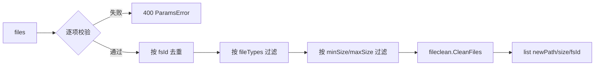
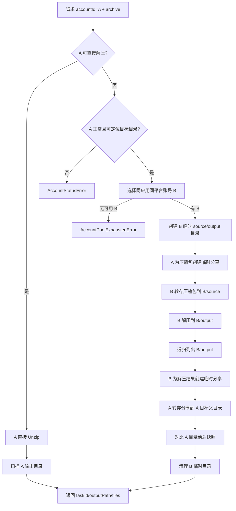
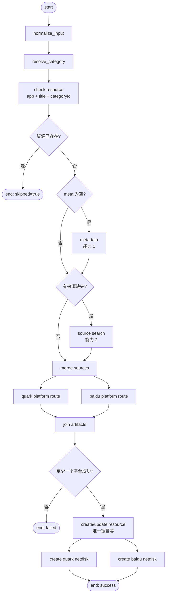
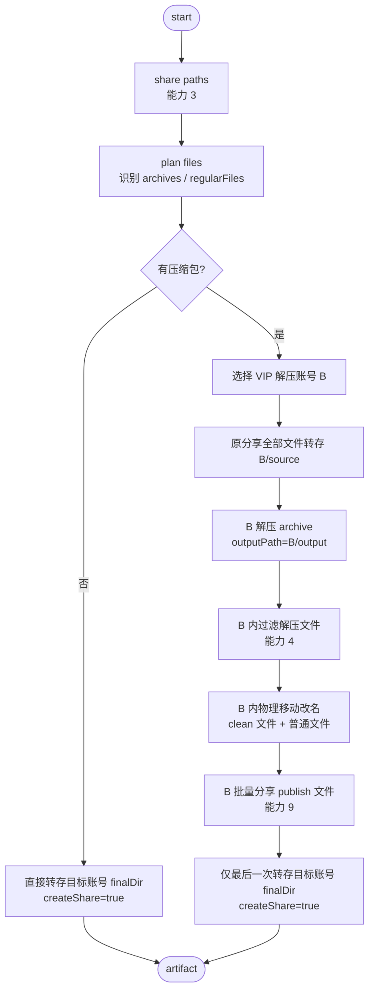

# 书籍导入技术方案（9 原子能力版）

> 状态：9 个原子能力已完成升级并通过 `go test ./...`、`go vet ./...`、`pnpm exec vue-tsc --noEmit`、`pnpm build`；新增 `POST /psou/admin/file/clean`、`POST /psou/admin/account/file/share`、`POST /psou/admin/account/unzip/select`，`flat/filter`、转存 `items/targetDir/createShare`（`excludeAccountIds` 仍保留为通用能力）、解压 `outputPath`、批量分享和目录 `path` 均已落地。调度链已在 `app=psou_us` 创建：`id=12`、`keyword=resource_import`；v13 为 `chain_version.id=29`，采用“先识别压缩包 → 原分享直接转存 VIP 解压账号 → 解压过滤并物理整理 → 批量分享 → 最后按 `NewPath` 转存目标账号”的顺序。账号未配置 `unzipDir` 时统一使用 `/psou/unzip`，链工作目录为 `workDir/{runId}-{platform}/{source|output|publish}`；最终目录为 `/psou/manual/{firstCategory}/{categoryName}/{title}`，并保留 `NewPath` 的多级目录；创建资源前标签去重并只保留前 3 个。
> 日期：2026-11-05
> 目标：用 9 个原子能力完成“标题 -> 元数据 -> 来源 -> 分享路径 -> 过滤 -> 转存 -> 解压 -> 移动到目标目录 -> 分享最终目录”。
> 原则：只升级现有接口；除独立的过滤、移动原子接口外不新增文件处理路由；不引入任务表、租约或额外状态机。
> 注意：同目录的 `book-import.chain.json`、`book-import-platform.chain.json` 是旧版草案；其中仍引用任务表、来源冻结、workspace/archive/publish 等当前不存在的路由，不要直接导入运行。`book-import.input.json` 已同步为当前输入契约。

## 1. 接口清单与核对结论

| # | 能力 | 原接口 | 当前状态 | 本次新增字段 |
| --- | --- | --- | --- | --- |
| 1 | 按标题取元数据 | `GET /psou/admin/resource/metadata` | 已可用 | 无 |
| 2 | 按标题查网盘来源 | `POST /psou/admin/search/quick` | 已可用，`type=url` 时数据在 `data.list` | `type`、`auxiliaryKeywords`、`limitPerPlatform`、`titleMatch` |
| 3 | 取分享链接的路径数组 | `POST /psou/admin/search/files` | 已实现 `flat=true` 扁平化和 `filter=true` 一步过滤 | 请求：`flat`、`filter`；响应复用 `list`，不新增数组字段 |
| 4 | 过滤路径数组 | `POST /psou/admin/file/clean` | 已新增并封装 `pkg/fileclean` | `files` 输入、严格校验、`list[].newPath/size/fsId` 输出 |
| 5 | 转存指定文件列表 | `POST /psou/admin/search/transfer` | 已支持自动选号、目标目录、可选分享和真实落地路径 | 请求：`targetDir`、`createShare`、`items`；响应：`targetDir`、`files[].newPath/fsId` |
| 6 | 解压指定文件 | `POST /psou/admin/account/file/unzip` | 已返回解压文件数组，支持指定 `outputPath`，并保留代理解压兜底 | 请求：`outputPath`；响应：`files[].path/size/fsId` |
| 7 | 移动文件到指定目录 | `POST /psou/admin/account/file/move` | 已实现单文件兼容和按目录批量移动，服务端按 500 项分批执行；`PUT /psou/admin/account/file` 只负责单文件重命名 | 移动请求：`targetPath` + `file/files` + `maxItems`；响应 `file/files`，元素 `newPath/size/fsId` |
| 8 | 创建网盘目录 | `POST /psou/admin/account/file/dir` | 已支持 `path` 多级创建，兼容旧参数 | 请求：`path`；响应：`path` + `id` |
| 9 | 分享最终文件/目录 | `POST /psou/admin/account/file/share` | 已新增；支持单文件 `file` 和批量 `files`，默认永久分享 | 请求：`accountId` + `file/files` + `title/period`；响应：`shareUrl/fileId/path/title/fileIds` |

解压账号选择：`POST /psou/admin/account/unzip/select`，只返回同时满足正常、未限流、VIP、解压账号、manual 转存/分享额度可用且工作目录可用的账号。

三个配套现有接口：

- 分类解析：`POST /psou/admin/category/resolve`，已可用。
- 创建资源：`POST /psou/admin/resource`，已可用。
- 创建网盘记录：`POST /psou/admin/netdisk`，已可用。

### 1.1 新增字段总览

下表只列本次新增字段；未列出的请求/响应字段均为现状已有。

| 接口 | 方向 | 新增字段 | 类型/说明 |
| --- | --- | --- | --- |
| `POST /psou/admin/search/files` | 请求 | `flat` | `bool`，把 `list` 展平成文件数组 |
| `POST /psou/admin/search/files` | 请求 | `filter` | `bool`，自动展平并执行广告过滤、改名；`true` 时直接返回有效文件 |
| `POST /psou/admin/search/files` | 请求 | `fileTypes` | `[]string`，固定文件类型白名单；空表示不限制 |
| `POST /psou/admin/file/clean` | 请求 | `files` | **新增接口**；待过滤文件数组 |
| `POST /psou/admin/file/clean` | 请求 | `files[].path` | `string`，原始文件路径 |
| `POST /psou/admin/file/clean` | 请求 | `files[].size` | `int64`，HTTP JSON 为字符串 |
| `POST /psou/admin/file/clean` | 请求 | `files[].fsId` | `string` |
| `POST /psou/admin/file/clean` | 响应 | `list` | **新增接口**；有效文件数组 |
| `POST /psou/admin/file/clean` | 响应 | `list[].newPath` | `string`，最终路径；不返回原始 `path` |
| `POST /psou/admin/file/clean` | 响应 | `list[].size` | `int64`，HTTP JSON 为字符串 |
| `POST /psou/admin/file/clean` | 响应 | `list[].fsId` | `string` |
| `POST /psou/admin/search/transfer` | 请求 | `targetDir` | `string`，绝对路径 |
| `POST /psou/admin/search/transfer` | 请求 | `createShare` | `bool`，`false` 时不创建临时分享 |
| `POST /psou/admin/search/transfer` | 请求 | `items` | 文件数组，替代旧 `files[]string` |
| `POST /psou/admin/search/transfer` | 请求 | `items[].newPath` | `string`，来自 `file/clean` 的有效路径 |
| `POST /psou/admin/search/transfer` | 请求 | `items[].fsId` | `string` |
| `POST /psou/admin/search/transfer` | 请求 | `excludeAccountIds` | `[]uint32`，`accountId=0` 自动选号时排除的账号 ID，最多 50 个 |
| `POST /psou/admin/search/transfer` | 响应 | `targetDir` | `string` |
| `POST /psou/admin/search/transfer` | 响应 | `files[].newPath` | `string`，落在目标目录后的路径 |
| `POST /psou/admin/search/transfer` | 响应 | `files[].fsId` | `string`，落地文件 ID |
| `POST /psou/admin/account/file/unzip` | 响应 | `files` | 解压后的文件数组 |
| `POST /psou/admin/account/file/unzip` | 响应 | `files[].path` | `string`，解压后的原始路径 |
| `POST /psou/admin/account/file/unzip` | 响应 | `files[].size` | `int64`，HTTP JSON 为字符串 |
| `POST /psou/admin/account/file/unzip` | 响应 | `files[].fsId` | `string` |
| `POST /psou/admin/account/file/move` | 请求 | `targetPath` | **新增接口**；目标目录绝对路径，必须已存在 |
| `POST /psou/admin/account/file/move` | 请求 | `file🆕` | 兼容单文件调用 |
| `POST /psou/admin/account/file/move` | 请求 | `files🆕` | 批量文件数组；同一 `targetPath` 下服务端按 500 项一批串行执行 |
| `POST /psou/admin/account/file/move` | 请求 | `maxItems🆕` | `uint32`，本次调用允许的最大文件数；默认 5000，超过直接拒绝 |
| `POST /psou/admin/account/file/move` | 请求 | `file.newPath` / `files[].newPath🆕` | `string`，来自 `file/clean` 的有效路径；批量时 files 中每种目标文件名不可重复 |
| `POST /psou/admin/account/file/move` | 请求 | `file.fsId` / `files[].fsId🆕` | `string`，文件唯一标识；批量时不可重复 |
| `POST /psou/admin/account/file/move` | 响应 | `file🆕` | 单个移动结果，兼容旧调用方 |
| `POST /psou/admin/account/file/move` | 响应 | `files🆕` | 批量移动结果，顺序与请求一致 |
| `POST /psou/admin/account/file/move` | 响应 | `file.newPath🆕` | `string`，目标目录下的实际路径 |
| `POST /psou/admin/account/file/move` | 响应 | `file.size🆕` | `int64`，HTTP JSON 为字符串 |
| `POST /psou/admin/account/file/move` | 响应 | `file.fsId🆕` | `string` |
| `PUT /psou/admin/account/file` | 请求 | `file🆕` | 单个文件对象，替代原扁平 `fileId/parentRef/path/name` |
| `PUT /psou/admin/account/file` | 请求 | `file.fileId` | `string`，文件/目录 ID |
| `PUT /psou/admin/account/file` | 请求 | `file.parentRef` | `string`，父目录引用 |
| `PUT /psou/admin/account/file` | 请求 | `file.path` | `string`，绝对路径，百度使用 |
| `PUT /psou/admin/account/file` | 请求 | `file.name` | `string`，新名称（含扩展名） |
| `POST /psou/admin/account/file/dir` | 请求 | `path` | `string`，支持多级的完整目录 |
| `POST /psou/admin/account/file/dir` | 响应 | `path` | `string`，创建或命中的目录路径 |
| `POST /psou/admin/account/file/share` | 请求 | `file` | **新增接口**；单个文件/目录对象 |
| `POST /psou/admin/account/file/share` | 请求 | `file.fileId` | `string`，目录/文件 ID；夸克必填 |
| `POST /psou/admin/account/file/share` | 请求 | `file.path` | `string`，绝对路径；百度可在无 fileId 时解析 |
| `POST /psou/admin/account/file/share` | 请求 | `files[]` | 批量分享；每个元素结构同 `file`，整批生成一个分享 |
| `POST /psou/admin/account/file/share` | 请求 | `title` | `string`，默认取路径 basename |
| `POST /psou/admin/account/file/share` | 请求 | `period` | `string`，默认 `0` 永久；可选 `0/1/7/30` |
| `POST /psou/admin/account/file/share` | 响应 | `shareUrl` | `string`，已合并百度提取码 |
| `POST /psou/admin/account/file/share` | 响应 | `fileId/path/title` | `string`，实际分享目标与标题 |
| `POST /psou/admin/account/file/share` | 响应 | `fileIds` | `[]string`，本次实际放进分享的全部文件/目录 ID |
| `POST /psou/admin/account/file/unzip` | 请求 | `outputPath` | `string`，显式指定本次解压输出目录；优先于账号 `unzipDir` |
| `POST /psou/admin/account/unzip/select` | 请求 | `platform/excludeAccountId` | **新增接口**；按平台选 VIP 解压账号，可排除目标账号 |
| `POST /psou/admin/account/unzip/select` | 响应 | `accountId/platform/name/workDir` | 可实际承担转存、解压和分享的解压账号及工作目录 |

明确约束：

- 新增 `POST /psou/admin/file/clean`、`POST /psou/admin/account/file/move` 和 `POST /psou/admin/account/file/share` 三个独立路由；其他文件能力只升级现有接口。
- 不使用已存在的 `POST /psou/admin/metadata/resolve` 作为链节点；元数据统一走能力 1
- 不新增 `/psou/admin/source/resolve`
- 不新增 `source/freeze`
- 不建 `import_task`、`import_task_source`、`file_manifest`
- 不做 claim/租约
- 过滤接口单次调用直接返回最终数组，不做 `preview/apply/verify` 三段式状态接口

## 2. 统一约定

1. 所属应用由 cron 运行上下文确定，请求体不传 `app`，调用方不配置应用身份头。
2. 普通 JSON 接口统一包一层成功信封，业务字段全部在 `data` 中：
   ```json
   {"code":200,"message":"success!","data":{}}
   ```
3. 失败使用 HTTP 状态码和顶层 `code/reason/message/metadata`，不返回业务 `data`。例如：
   ```json
   {"code":404,"reason":"CategoryNotFoundError","message":"分类不存在:二级分类不存在","metadata":{}}
   ```
4. 本文所有路径都是账号网盘根目录下的绝对路径，例如 `/psou/manual/书籍/漫画绘本/xxx.pdf`。
5. 第 3、4、5、7 项只处理文件，不接收目录。目录必须先展平成文件数组。
6. 第 5 项可以传 `accountId=0`，由服务端自动选可用账号并返回实际值；第 6、7、8 项必须使用第 5 项返回的同一个 `accountId`。解压自动调度只改变内部执行账号，不改变请求 `accountId` 和返回文件的归属账号。
7. 批量接口的单项失败不能静默吞掉；要么整批失败，要么在响应的 `failed` 中逐项返回。
8. proto 的 `int64` 字段经 HTTP JSON 序列化后是字符串，例如 `"size":"10052070"`、`"totalSize":"10052070"`。`double` 和 `uint32` 字段仍是数字。文档示例已按实际类型书写。
9. 本文的“现状”是当前接口真实行为；“目标”才是需要开发的字段和返回，不得混用。
10. `🆕` 表示该字段/返回项当前 proto 和接口都还没有，属于本次方案新增；未标记的字段均为现状已有。标记为“新增接口”的能力表示连路由都不存在。
11. 分享、转存以及内部会触发分享/转存的解压节点统一使用两段重试：`Chain.Timeout/Network/Http5xx` 最多重试 4 次，间隔 5 秒起步、2 倍退避、单次上限 60 秒；`Chain.RateLimited` 最多重试 4 次，间隔 30 秒起步、2 倍退避、单次上限 300 秒。重试耗尽后命中挂起条件时，运行持久化延迟重跑时间，由 Sweeper 到期后只重跑当前节点。
12. 夸克业务码 `41030` 表示账号被平台临时限制转存，按限流处理并返回 HTTP 429，不能归为普通 `SearchTransferError`；HTTP 429 同样按平台限流归类。

## 3. 接口定义

### 3.1 能力 1：按标题取元数据（复用）

`GET /psou/admin/resource/metadata?title=父与子的编程之旅`

请求：

| 参数 | 必填 | 说明 |
| --- | --- | --- |
| `title` | 是 | 资源标题，最长 255 |
| `type` | 否 | `auto/movie/tv/book`；不传走 `auto`。书籍链需要强约束时再传 `book`，不写死 |

响应：

```json
{
  "metadata": {
    "title": "父与子的编程之旅",
    "summary": "本书是一本家长与孩子共同学习编程的入门书。作者是一对父子，他们以Python语言为例，详尽细致地介绍了Python如何安装、字符串和操作符等程序设计的基本概念，介绍了条件语句、函数、模块等进阶内容，最后讲解了用Python实现游戏编程。书中的语言生动活泼，叙述简单明了。 为了让学习者觉得编程有趣，本书编排了很多卡通人物及场景对话，让学习者在轻松愉快之中跨入计…",
    "description": "本书是一本家长与孩子共同学习编程的入门书。作者是一对父子，他们以Python语言为例，详尽细致地介绍了Python如何安装、字符串和操作符等程序设计的基本概念，介绍了条件语句、函数、模块等进阶内容，最后讲解了用Python实现游戏编程。书中的语言生动活泼，叙述简单明了。 为了让学习者觉得编程有趣，本书编排了很多卡通人物及场景对话，让学习者在轻松愉快之中跨入计算机编程的大门。\n第 2 版新增内容\n首先，我们来说说第 2 版中有哪些内容没有改变，那就是我们决定在第 2 版中继续使用 Python 2，而不是转换到 Python 3。我们会在第 1 章解释其中的原因。\n下面是第 2 版与第 1 版的不同之处\n增加了一些说明，解释 Python 2 和 Python 3 的区别。\n第 12 章增加了一节关于 Python 字典的内容。\n在第 20 章的 GUI 编程部分，我们将不再被支持的 PythonCard 换成了应用更广泛的 PyQt。PyQt 也用在第 22 章的 Hangman 程序和第 24 章的电子宠物程序中。\n增加了第 25 章，用来详细解释第 10 章中的 Skier 程序。\n增加了第 26 章，讲述在简单的对战游戏中，如何编写一个有人工智",
    "tags": ["图书"],
    "score": 8.2,
    "year": "2014",
    "kind": "book",
    "source": "douban",
    "sourceUrl": "https://book.douban.com/subject/26005639/",
    "cover": "7320e8871c4fb4d43c0ec909d22dd07a.jpg",
    "coverError": "",
    "covers": ["7320e8871c4fb4d43c0ec909d22dd07a.jpg"]
  }
}
```

链上取 `${response.data.metadata}`。该接口由现有三方元数据检索提供，不新增代码。`type` 是接口的可选能力，不是本链的固定参数。

注意：

`summary` 是用于列表/卡片的摘要，可能带省略号；`description` 是三方详情页返回的简介原文，不保证与 `summary` 相同，也可能被三方数据源自身截断。

1. `covers` 是完整候选数组；`cover` 是兼容旧客户端的字段，默认等于 `covers[0]`，两者都不为空时优先读 `covers`。
2. `covers[0]` 当前实测是对象 key（如 `7320e...jpg`），不保证是完整 URL；发布前通过现有资源 URL 解析能力换取可访问地址。
3. `coverError` 仅在上传或取图失败时返回；为空表示当前封面可用。
4. 内部任务没有登录态时，服务端会使用系统用户身份上传封面；归属用户可通过 `PSOU_RESOURCE_SYSTEM_USER_ID` 配置，默认 `1`。
5. `kind` 是实际命中的资源类型，可用来判断是否误命中电影或剧集。

### 3.2 能力 2：按标题查来源（复用）

`POST /psou/admin/search/quick`

请求：

```json
{"keyword":"父与子的编程之旅","type":"url","limitPerPlatform":1,"titleMatch":true}
```

| 参数 | 必填 | 实际约束 |
| --- | --- | --- |
| `keyword` | 是 | 1～128 字符，不能传分享链接 |
| `type` | 否 | `token`（默认）或 `url`；链上固定传 `url` 以获取原始分享地址 |
| `limitPerPlatform` | 否 | 0～50；缺省或 0 时按 10 处理 |
| `titleMatch` | 否 | 默认 `false`；链上显式传 `true`，只保留标题包含 `keyword` 的候选 |
| `auxiliaryKeywords` | 否 | 最多 10 个，每个最多 64 字符；拼入检索词，并参与同级排序 |

实际响应（外层统一信封，业务数据在 `data.list`）：

```json
{
  "code": 200,
  "message": "success!",
  "data": {
    "list": [
      {
        "platform": "quark",
        "title": "父与子的编程之旅:与小卡特一起学Python (图灵程序设计丛书) - [美] Warren Sande",
        "shareUrl": "https://pan.quark.cn/s/a264ac74705a?pwd=ecV5",
        "password": "ecV5",
        "source": "plugin:melost"
      }
    ]
  }
}
```

字段语义：

1. `platform` 只会是 `baidu`、`quark`，但不保证两个平台都有结果；结果按百度、夸克分组返回。
2. `title` 是检索源的原始备注，可能带副标题、版本、作者；不能当作最终书名，最终书名使用链输入或元数据结果。
3. `shareUrl` 可能已带 `pwd`，同时 `password` 也会单独返回；后续接口直接用 `shareUrl` 即可，`password` 只在需要时补充。
4. `source` 是检索插件来源（例如 `plugin:melost`），不是“夸克/百度”的展示名。
5. `type=url` 时 `token` 为空，接口返回原始 `shareUrl/password`；链上后续统一使用 `shareUrl`。`type=token` 时保持原 token 响应，不返回原始地址。

每个平台内部按标题相关度稳定排序，再执行链接有效性检测和 `limitPerPlatform` 截断：

1. 归一化标题与 `keyword` 完全相等；
2. `keyword` 是标题前缀，或被空白、标点、符号分隔为完整标题段；
3. 标题普通包含 `keyword`；
4. 同等级按辅助词命中数量降序；
5. 再按归一化后的标题长度升序；
6. 仍相同时保持检索源原始顺序。

链上只采纳 `quark`、`baidu` 两个平台，每个平台取第一条。其他平台或空列表直接跳过，不生成该平台任务。

### 3.3 能力 3：取分享链接的路径数组（升级 `POST /psou/admin/search/files`）

**升级前契约**

升级前请求字段（新增字段见下）：

| 参数 | 必填 | 说明 |
| --- | --- | --- |
| `token` | 否 | 搜索接口签发的短期凭证；与 `shareUrl` 二选一，传了 `token` 时优先使用 |
| `shareUrl` | 否 | 分享链接；没有 `token` 时必填，平台从 host 自动识别 |
| `password` | 否 | 提取码；链接已带 `pwd` 时可空 |
| `platform` | 否 | `baidu/quark`；传了必须与链接平台一致 |
| `dirFsId` | 否 | 读取分享中的指定子目录 |
| `dirPath` | 否 | 读取分享中的指定子路径 |
| `meta` | 否 | 树接口返回的续页/分享元信息，原样回传 |

升级前请求示例：

```json
{
  "shareUrl": "https://pan.quark.cn/s/a264ac74705a?pwd=ecV5",
  "password": "ecV5"
}
```

升级前响应：

```json
{
  "code": 200,
  "message": "success!",
  "data": {
    "list": [
      {
        "fsId": "6ece4242c74c4416b4f4bf7526d83fa9",
        "name": "父与子的编程之旅：与小卡特一起学Python (图灵程序设计丛书) - [美] Warren Sande .mobi",
        "isDir": false,
        "size": "10052070",
        "path": "/父与子的编程之旅：与小卡特一起学Python (图灵程序设计丛书) - [美] Warren Sande .mobi",
        "hasChildren": false,
        "children": []
      }
    ],
    "totalFiles": "1",
    "totalSize": "10052070",
    "meta": ""
  }
}
```

升级前限制：

1. 只返回 `list` 文件树，没有 `flat`；过滤由独立能力 4 完成。
2. 根目录默认展开两层；传 `dirFsId` 或 `dirPath` 时只列该目录一层。
3. `size/totalFiles/totalSize` 都是 JSON 字符串。
4. 响应没有 `platform/shareUrl`；这两个字段只在请求侧出现。
5. 夸克分享的 `path` 可作为后续校验字段，但真正操作仍以 `fsId` 为准。

**升级后契约**

请求增加 `flat` 和 `filter`：

```json
{
  "shareUrl": "https://pan.quark.cn/s/a264ac74705a?pwd=ecV5",
  "filter": true,
  "fileTypes": ["video"]
}
```

- `flat=true🆕`：复用现有 `SearchFileItem`，直接把 `list` 改成扁平文件数组；只保留 `isDir=false` 的条目，`children` 置空，`hasChildren=false`。
- `filter=true🆕`：隐含展平；对文件数组调用 `pkg/fileclean`，广告文件直接消失，命中改名规则的文件保留并把 `path` 更新为最终路径，`name` 同步更新为最终文件名。
- `fileTypes🆕`：固定类型白名单，支持 `video/视频`、`audio/音频`、`subtitle/字幕`、`image/图片`、`document/文档`、`software/软件`、`archive/压缩包`；多个类型为 OR，空数组表示不限制。链的源文件预筛会自动追加 `archive`，避免压缩包被提前过滤。
- `filter=false` 或未传：不执行过滤，行为与旧接口一致；需要两步处理时仍可先 `flat=true`，再调用能力 4。
- `filter=true` 时 `totalFiles/totalSize` 按过滤后的文件重新计算；响应不额外增加 `newPath` 字段。

升级后响应示例：

```json
{
  "list": [
    {
      "fsId": "6ece4242c74c4416b4f4bf7526d83fa9",
      "name": "父与子的编程之旅：与小卡特一起学Python (图灵程序设计丛书) - [美] Warren Sande .mobi",
      "isDir": false,
      "size": "10052070",
      "path": "/父与子的编程之旅：与小卡特一起学Python (图灵程序设计丛书) - [美] Warren Sande .mobi",
      "hasChildren": false,
      "children": []
    }
  ],
  "totalFiles": "1",
  "totalSize": "10052070",
  "meta": ""
}
```

已实现行为：

1. `flat=false && filter=false` 时保留原有 `Search.ListFiles` 行为和 `list` 树，确保老调用方不受影响。
2. 请求带 `flat=true || filter=true` 时，递归展平分享树，把文件节点追加到 `list`，只保留 `isDir=false` 的条目；不返回目录，也不携带 `children`。
3. 仅 `flat=true`、未开 `filter` 时，不改变 `path/name/size/fsId` 的原始值；调用方随后把文件数组提交给能力 4。
4. `filter=true` 时，由 `pkg/fileclean` 按广告词置信度、文件类型和大小统一判定：明确广告文件剔除，正文水印清洗后保留；输出只包含有效文件。
5. 按 `fsId` 去重；重复项保留第一次出现的节点。
6. 展平深度沿用现有勾选扫描的 12 层上限；超深目录要明确报错，不能静默截断。

说明：当前统一 JSON 编码会把空 repeated 字段输出为 `children: []`。本次只保证不再返回子节点；如果要连字段名也完全省略，需要单独调整 proto presence 或 JSON 编码策略。

当前失败原因可直接复用：

- 链接/提取码不合法：`ParamsError`
- 分享失效：`SearchShareExpiredError`，HTTP 400
- 提取码错误：`SearchPasswordError`，HTTP 400
- 无可用读取账号：`SearchNoShareAccountError`，HTTP 503
- 其他平台列举失败：`SearchTransferError`，HTTP 500

### 3.4 能力 4：过滤路径数组（新增 `POST /psou/admin/file/clean🆕`）

过滤规则仍由 `pkg/fileclean` 统一提供。`search/files` 可以通过 `filter=true` 直接复用同一套规则；本接口则保留给解压结果、外部文件数组等需要单独过滤的场景。接口只做“输入文件数组 -> 校验 -> 广告过滤与改名计算 -> 输出有效文件数组”，不访问网盘，不移动、不删除、不改名。

请求：

```json
{
  "files": [
    {
      "path": "/父与子的编程之旅/父与子的编程之旅：与小卡特一起学Python (图灵程序设计丛书) - [美] Warren Sande .mobi",
      "size": "10052070",
      "fsId": "6ece4242c74c4416b4f4bf7526d83fa9"
    }
  ],
  "fileTypes": ["document"]
}
```

响应：

```json
{
  "code": 200,
  "message": "success!",
  "data": {
    "list": [
      {
        "newPath": "/父与子的编程之旅/父与子的编程之旅.pdf",
        "size": "10052070",
        "fsId": "6ece4242c74c4416b4f4bf7526d83fa9"
      }
    ]
  }
}
```

请求字段：

| 参数 | 必填 | 约束 |
| --- | --- | --- |
| `files` | 是 | 文件数组，不允许目录；空数组合法并返回空 `list` |
| `files[].path` | 是 | 非空；必须有 basename；不能以 `/` 结尾；不能是 `.` 或 `..` |
| `files[].size` | 是 | `> 0`；HTTP JSON 传字符串 |
| `files[].fsId` | 是 | 非空，按 `fsId` 去重 |
| `fileTypes` | 否 | 固定类型白名单；空表示不限制；多个类型 OR；未知类型返回 `ParamsError` |
| `minSize` / `maxSize` | 否 | 字节数；`0` 表示不限制；过滤顺序为类型 -> 大小 -> 广告清洗 |

接口没有 `isDir` 字段，无法识别不带尾斜杠的目录；调用方必须只提交文件条目。API 会拒绝空路径、`.`、`..`、尾斜杠等可识别目录特征，不能把目录交给 `fileclean` 处理。

响应字段只有 `list[].newPath/size/fsId`。不返回原始 `path`，调用方不得依赖输入路径继续计算；后续操作使用 `newPath` 和 `fsId`。

处理流程：



接口实现固定调用：

```go
fileclean.CleanFiles([]fileclean.Input) []fileclean.Output
```

语义固定：

1. 过滤和改名都算强命中。
2. 命中广告规则的文件直接从 `list` 消失；命中改名规则的文件保留，并返回计算后的 `newPath`。
3. 未命中改名规则时，`newPath` 等于输入 `path`；命中改名时，只替换 basename，目录部分和扩展名保持不变。最后统一裁掉所有有效文件共同的目录前缀，避免保留无意义的深层目录。
4. 输出按 `fsId` 去重；重复 `fsId` 保留第一条。
5. 多个文件计算后落到同一个 `newPath` 时，冲突项在 `newPath` 中回退为各自的输入路径，避免批量改名互相覆盖。
6. API 层先做严格校验：任意一项缺 `path/size/fsId`、`size <= 0` 或路径是目录特征时，整个请求返回 `400 ParamsError`，不会像 `CleanFiles` 那样静默跳过。规则命中导致的剔除不是错误。
7. 输入全部被过滤或输入为空时，返回 `200` 和 `list: []`，由调用方决定是否终止当前平台链。
8. 接口无网盘副作用且可重复调用；相同输入返回相同结果。

### 3.5 能力 5：转存指定文件列表（升级 `POST /psou/admin/search/transfer`）

**升级前契约**

升级前请求：

```json
{
  "accountId": 3,
  "shareUrl": "https://pan.quark.cn/s/a264ac74705a?pwd=ecV5",
  "password": "ecV5",
  "dirName": "父与子的编程之旅",
  "files": ["6ece4242c74c4416b4f4bf7526d83fa9"]
}
```

| 参数 | 必填 | 说明 |
| --- | --- | --- |
| `accountId` | 是 | 必须是已存在的正常账号，且平台与分享链接一致 |
| `shareUrl` | 是 | 来源分享链接；也可改用 `token` |
| `password` | 否 | 链接已带 `pwd` 时可空 |
| `dirName` | 否 | 在账号配置的手动转存目录下创建的子目录；为空时自动生成名字 |
| `files` | 否 | 分享内文件的 `fsId` 数组；为空表示转存整个分享 |

当前实际响应：

```json
{
  "accountId": 3,
  "platform": "quark",
  "fsId": "转存目录的fsId",
  "shareUrl": "https://pan.quark.cn/s/new-share?pwd=xxxx",
  "size": 10052070,
  "fileCount": "1",
  "folderCount": "0",
  "files": [
    {
      "name": "父与子的编程之旅：与小卡特一起学Python (图灵程序设计丛书) - [美] Warren Sande .mobi",
      "isDir": false,
      "size": 10052070
    }
  ]
}
```

升级前限制：

1. `accountId` 必填且必须大于 0，不会自动选账号。
2. 只接受 `files []fsId`，没有 `items`。
3. 没有 `targetDir`；目标目录固定为账号配置的手动转存目录加 `dirName`。
4. 每次都会在转存完成后调用底层创建分享；没有 `createShare=false`。
5. 返回的 `files[]` 只有 `name/isDir/size`，没有真实落地路径和文件 `fsId`。
6. `fsId` 是转存目录标识，不是单个文件标识；`size` 是数字，`fileCount/folderCount` 是字符串。

**升级后契约**

请求：

```json
{
  "accountId": 0,
  "shareUrl": "https://pan.quark.cn/s/a264ac74705a?pwd=ecV5",
  "targetDir": "/psou/manual/import/20261105-001",
  "createShare": false,
  "items": [
    {"newPath": "第一季/父与子的编程之旅.pdf", "fsId": "6ece4242c74c4416b4f4bf7526d83fa9"}
  ]
}
```

新增字段：

- `accountId=0`：语义升级，不是新字段；按平台自动选择正常账号。
- `excludeAccountIds🆕`：可选，仅在 `accountId=0` 自动选号时生效；用于调用方自行排除账号，`book_import_single` v13 已不再传入。
- `targetDir🆕`：本次转存的目标目录，必须使用绝对路径；为空时保持现有手动转存目录行为。
- `createShare🆕`：为 `false` 时跳过后台创建分享，只返回落地文件。
- `items🆕`：与旧 `files` 二选一；每项必须带 `fsId` 和 `newPath`。`newPath` 表示相对 `targetDir` 的最终路径，可以包含多级目录；文件定位仍以 `fsId` 为准。带前导 `/` 时只去掉根斜杠，不改变其相对层级。
- 响应新增 `targetDir🆕`，`files[]` 新增 `newPath🆕/fsId🆕`；`size` 字段原本已存在，只是内部类型改为 `int64`。

响应示例：

```json
{
  "accountId": 3,
  "platform": "quark",
  "targetDir": "/psou/manual/import/20261105-001",
  "files": [
    {
      "newPath": "/psou/manual/import/20261105-001/父与子的编程之旅.pdf",
      "fsId": "landed_001",
      "size": "10052070"
    }
  ]
}
```

已实现行为：

1. 保留现有 `files []string`、`dirName` 字段，老调用方行为不变。
2. `accountId=0` 时调用 `Account.SelectAccount(platform, manual)`；如传入 `excludeAccountIds`，则加入选号排除集合。
3. 目标目录不存在时调用 `EnsureDir` 创建。
4. 调用底层 `PanClient.TransferToDir`。
5. `createShare=false` 时跳过现有 `CreateShare`，只返回落地文件。
6. 转存后重新列举 `targetDir`，返回真实落地路径和 fsId。
7. `items` 模式下，源分享 `fsId` 与落地 `fsId` 不同。服务端先在源分享树中解析每个源 `fsId` 的原始文件名，再用落地文件名与之对齐，确保 `files[].newPath/fsId` 指向正确文件；不能拿源 `fsId` 直接匹配落地条目。
8. 服务端按 `newPath` 的父目录分组转存：`第一季/1.mp4` 与 `第二季/1.mp4` 会分别落到 `targetDir/第一季`、`targetDir/第二季`，不会在 `targetDir` 根目录互相覆盖。
9. 同一目标父目录下的原始文件名重复、或最终路径重复时返回 `ParamsError`；不同父目录下的同名源文件允许同时存在。
10. `newPath` 拒绝空路径、`..`、控制字符和非法目录段；每个目录段都会校验长度与平台文件名限制。
11. 同账号分享转存时，目标目录已有同名同类型文件视为已落地，直接复用目标 `fsId`，不重复 move；大小不同只告警。普通 `account/file/move` 仍按同名不同 `fsId` 返回 `MOVE_CONFLICT`。

当前失败行为：

- 账号不存在：`AccountNotFoundError`，HTTP 404。
- 账号状态/限流：`AccountStatusError`，HTTP 500。
- 分享失效、提取码错误：分别为 `SearchShareExpiredError`、`SearchPasswordError`，HTTP 400。
- 其他平台错误：`SearchTransferError`，HTTP 500。

### 3.6 能力 6：解压指定文件（升级 `POST /psou/admin/account/file/unzip`）

**当前实现**

不新增路由、不新增必填请求字段，保持调用方视角不变：

当前调度链（v13）不再使用本接口的“A 中转 + B 代理回传”闭环，而是先选中 B，把原分享直接转存 B，再显式调用本接口让 B 解压到 `outputPath`。B 的候选集合不再排除目标账号 A。下面描述的代理解压逻辑保留给仍只传 A 的旧调用方。

- 请求里的 `accountId` 始终是压缩包所在账号 A，也是解压结果的归属账号。
- 新增可选字段 `outputPath`；传入后优先于账号 `unzipDir`，用于调度链为每次运行创建隔离的解压目录。
- A 同时满足 `VIP + 解压账号` 时，继续走现有直解流程；账号限流状态不影响解压资格。
- A 仅缺少 VIP 或解压资格时，服务端自动选择同应用、同平台的账号 B 代理解压，再把结果转回 A。
- 解压账号可在账号设置中配置 `unzipDir`。配置后，直解结果落到该目录；未配置时统一落到默认目录 `/psou/unzip`，不再回退到 manual 转存目录。代理解压时 B 的临时工作目录放在 `B.unzipDir/.unzip/{jobId}` 下，未配置 `unzipDir` 时使用 `/psou/unzip/.unzip/{jobId}`。
- A 登录态失效或不能创建/转存分享时，不自动换号；因为结果无法可靠回到 A，直接返回账号错误。
- 无可用 B 时返回 `AccountPoolExhaustedError`，不能把文件留在 B 或其他账号。
- 调用方不传 `executorAccountId`、`unzipAccountId` 或 B 的任何凭证；选号完全由服务端完成。

请求保持：

```json
{
  "accountId": 3,
  "fileId": "landed_zip_001",
  "path": "/psou/manual/import/20261105-001/合集.zip",
  "parentRef": "",
  "name": "合集.zip"
}
```

| 参数 | 必填 | 说明 |
| --- | --- | --- |
| `accountId` | 是 | 压缩包所在账号 A，也是最终解压结果归属账号 |
| `fileId` | 是 | A 账号内压缩包文件 ID |
| `path` | 条件必填 | 压缩包绝对路径；百度用于定位压缩包，不再用于推导解压目标目录 |
| `parentRef` | 否 | 用于定位压缩包所在平台目录；解压目标目录由 `outputPath`、账号 `unzipDir` 或默认 `/psou/unzip` 决定 |
| `name` | 是 | 压缩包完整名称；必须命中支持的压缩包扩展名 |

账号更新接口新增可选字段 `unzipDir`：`nil` 表示不修改，空字符串表示清除，非空值必须是根目录以外的绝对路径，最大 512 字符。设置时服务端会通过 `EnsureDir` 校验并创建目录；已配置的目录不会因为关闭“解压账号”开关而被清除。

响应仍为 `taskId/outputPath/files`，新增字段只有 `files🆕`：

```json
{
  "taskId": "unzip_task_001",
  "outputPath": "/psou/manual/import/20261105-001/合集",
  "files": [
    {
      "path": "/psou/manual/import/20261105-001/合集/1.pdf",
      "fsId": "fs_101",
      "size": "2048"
    }
  ]
}
```

响应字段语义：

- `taskId`：直解时返回 A 的解压任务 ID；代理解压时返回 B 的解压任务 ID，平台未返回时返回 `delegated_{jobId}`。
- `outputPath`：结果在 A 账号内的输出路径。优先级为请求 `outputPath` > 账号 `unzipDir` > 默认 `/psou/unzip`；目标目录下只新增一个顶层目录时取其路径，新增多个顶层条目或只有文件时取目标父目录。
- `files`：A 账号内解压后的完整文件数组，路径是原始 `path`，不在这里调用 `pkg/fileclean`，也不返回 `newPath`。
- 不返回执行账号 B 的 `accountId`、token 或分享链接；执行账号只写服务端日志，外部调用方继续使用请求中的 A。

**判断与选号**

```text
A 可直接解压 = A.status=normal && A.token 非空
             && A.isVip=true && A.isUnzipAccount=true

A 可代理解压 = A.status=normal && A.token 非空
             && (!A.isVip || !A.isUnzipAccount)
             && A.manualTransferAvailable && A.manualShareAvailable

B 可作为执行账号 = B.status=normal && B.platform=A.platform && B.id != A.id
                 && B.isVip=true && B.isUnzipAccount=true
                 && B.manualTransferAvailable && B.manualShareAvailable
                 && (B.unzipDir 有效 || 默认目录 /psou/unzip 可用)
```

选号规则：

1. 只在当前应用（`app` 来自请求上下文）和 A 的平台内选择，禁止夸克压缩包交给百度账号、或反向跨平台处理。
2. 排除 A 本身，避免“自动调度”又选中同账号。
3. `selectUnzipExecutor` 复用 infra 层 `SelectUnzipAccount`：查询正常账号后按优先级降序、剩余容量降序、账号 ID 升序选择第一个满足条件的 B。
4. infra 选号会排除 A、限流账号、非 VIP/非解压账号及 manual 转存/分享额度不可用的账号；解压工作目录由账号 `unzipDir` 决定，未配置时使用 `/psou/unzip`，不再要求 manual 目录 `path/fsId` 完整。

**代理解压流程**



步骤与中途产物：

1. 生成一次性 `jobId`；B 临时目录使用 `B.unzipDir/.unzip/{jobId}/source` 和 `.../output`，未配置 `unzipDir` 时使用 `/psou/unzip/.unzip/{jobId}`，均通过 `EnsureDir` 创建。
2. 调用 `PanClient.CreateShare`，由 A 以压缩包 `fileId` 创建临时分享。百度使用 1 天有效期；夸克忽略有效期。分享 URL 和密码只保存在本次请求内存中。
3. 调用 `PanClient.TransferToDir`，由 B 用自己的 token 把 A 的压缩包分享转存到 B 的 `source` 目录；必须得到且只得到一个落地压缩包。
4. 调用 `PanClient.Unzip`，B 以落地压缩包的 `fsId` 解压到 B 的 `output` 目录；继续沿用现有同步等待语义。夸克需要把 `output` 解析为目录 fid 后传 `parentRef`，百度传绝对路径。
5. 解压完成后递归列举 B 的 `output` 目录，得到顶层条目和全部文件。顶层为空时返回 `UpdateError`，不能创建空分享。
6. 调用 `PanClient.CreateShare`，由 B 把 `output` 下的全部顶层条目放进同一个临时分享。顶层可能是一个目录、多个文件或混合条目，不能假设一定是单目录。
7. 解析 A 的目标目录：请求 `outputPath` 优先；否则账号 `unzipDir`；仍未配置时使用 `/psou/unzip`。目录不存在时调用 `EnsureDir` 创建。开始转存前记录该目录的顶层条目快照。
8. 调用 `PanClient.TransferToDir`，由 A 用自己的 token 把 B 的解压结果分享转存回 A 的目标父目录；`Files` 为空表示转存整个分享。
9. 重新列举 A 的目标父目录，与转存前快照对比，得到本次新增顶层条目。无法唯一定位新增内容时返回 `UpdateError`，不能把整个父目录误报成解压结果。
10. 递归展开新增顶层条目下的文件，返回 `files[]`。成功后 best-effort 删除 B 的 `source`、`output` 和 `.unzip/{jobId}` 临时目录；A 的源压缩包保留不动。

直解路径同样先记录同名输出目录内已有文件的 `fsId`。若平台把结果合并进已存在的同名目录、没有产生新顶层条目，则对比解压前后的文件集合，只返回新增文件；旧文件不会被误报为本次解压结果。

**兼容与约束**

1. 保持同步等待语义，不新增 `wait` 参数；转存、分享、解压都完成并且文件已回到 A 后才返回。
2. 本接口不调用 `pkg/fileclean`；返回的 `files[]` 仍需链上调用能力 4。
3. 只支持同平台代理解压；没有同平台 B 时失败，不尝试跨平台搬运。
4. A 必须是最终归属账号；不支持“A 不合格且 A 也不能分享/转存，就把结果留在 B”的降级。
5. 当前没有分享撤销接口，临时分享不能主动回收；百度使用 1 天有效期，夸克只能依赖平台默认行为。日志不得输出分享 URL、密码或账号 token。
6. 第一版不引入任务表或幂等键；接口超时后可能已完成部分步骤，调用方应先查询 A 的目标目录，不能直接盲目重试。
7. 代理解压会产生 A 建分享、B 转存、B 建分享、A 转存四次额度消耗；实现时分别调用 A/B 的 `BumpDailyTransfer`、`BumpDailyShare`，统一记在 `manual` 通路。

错误行为：

- A 状态异常或登录态失效：`AccountStatusError`，不进入代理解压。
- 无满足条件的 B：`AccountPoolExhaustedError`，HTTP 503。
- 压缩包类型不支持、缺少文件 ID、代理解压时无法确定 A 目标父目录：`ParamsError`。
- A/B 转存、分享或平台解压失败：`UpdateError`，错误信息只包含阶段和平台，不包含 token、分享密码。
- 解压结果为空、回传后无法唯一定位新增条目：`UpdateError`，保留现场便于排查，不继续返回可能错误的路径。

直解路径保留原有错误语义：

- 账号未设为解压账号/不是 VIP 且无可用 B：`AccountPoolExhaustedError`。
- 文件类型不支持/缺少文件 ID：`ParamsError`。
- 平台解压失败：`UpdateError`。

### 3.7 能力 7：重命名与批量移动（`PUT /psou/admin/account/file`、`POST /psou/admin/account/file/move🆕`）

**统一约定**

重命名一次只处理一个文件，继续使用 `file🆕`。移动保留单文件 `file🆕` 兼容，同时支持 `files🆕` 批量调用；批量调用要求所有文件落到同一个已存在 `targetPath`，服务端一次 move 后逐项按 `newPath` 改名。

移动是独立原子接口，不升级 `PUT /psou/admin/account/file`。`PUT` 继续只负责重命名，移动走 `POST /psou/admin/account/file/move🆕`。两个接口都不隐式创建目标目录；目录创建由能力 8 负责。

#### 3.7.1 单文件重命名（调整 `PUT /psou/admin/account/file`）

本次把原有扁平字段收进 `file🆕`；`accountId` 仍在顶层。前端和其他调用方需要同步改为嵌套结构。

**请求**

```json
{
  "accountId": 3,
  "file": {
    "fileId": "landed_001",
    "parentRef": "",
    "path": "/psou/manual/import/20261105-001/a.pdf",
    "name": "父与子的编程之旅.pdf"
  }
}
```

| 参数 | 必填 | 约束 |
| --- | --- | --- |
| `accountId` | 是 | 文件所在账号，必须正常且登录态有效 |
| `file🆕` | 是 | 单个文件对象，不是数组 |
| `file.fileId` | 是 | 文件/目录 ID，非空 |
| `file.parentRef` | 否 | 父目录引用；百度可用绝对路径，夸克为 fid |
| `file.path` | 否 | 绝对路径，百度使用 |
| `file.name` | 是 | 新名称，包含扩展名；不能包含路径分隔符或控制字符 |

**响应**

```json
{}
```

**处理语义**

1. 仅重命名，不移动；不接收 `targetPath`。
2. `accountId` 决定账号和平台， `file.fileId` 决定条目。
3. 名称校验沿用现有规则：去首尾空白后非空，不能是 `.`/`..`，不能包含 `/`、`\` 或控制字符。

#### 3.7.2 移动（`POST /psou/admin/account/file/move🆕`）

接口把指定 `fsId` 的文件移动到已存在的目标目录，并用输入 `newPath` 的 basename 完成最终改名。目标目录必须已存在，移动接口不隐式创建目录。批量模式按目标目录只发起一次平台 move，再逐项改名。

**单文件请求（兼容）**

```json
{
  "accountId": 3,
  "targetPath": "/psou/manual/书籍/漫画绘本",
  "file": {
    "newPath": "/psou/manual/import/20261105-001/父与子的编程之旅.pdf",
    "fsId": "landed_001"
  }
}
```

**批量请求**

```json
{
  "accountId": 3,
  "targetPath": "/psou/manual/书籍/漫画绘本/父与子的编程之旅",
  "files": [
    { "newPath": "父与子的编程之旅.azw3", "fsId": "landed_001" },
    { "newPath": "父与子的编程之旅.epub", "fsId": "landed_002" },
    { "newPath": "父与子的编程之旅.mobi", "fsId": "landed_003" }
  ]
}
```

| 参数 | 必填 | 约束 |
| --- | --- | --- |
| `accountId` | 是 | 文件所在账号，必须正常且登录态有效 |
| `targetPath` | 是 | 目标目录绝对路径；必须已存在，链上先调用能力 8 |
| `file🆕` | 二选一 | 单个文件对象，兼容旧调用方 |
| `files🆕` | 二选一 | 批量文件数组，最多 200 项；`file` 和 `files` 至少传一个 |
| `file.newPath` | 是 | 来自能力 4；不能为空、不能以 `/` 结尾，basename 必须是合法文件名 |
| `file.fsId` / `files[].fsId` | 是 | 文件唯一标识，不能为空，同一请求内不可重复 |

**响应**

```json
{
  "file": {
    "newPath": "/psou/manual/书籍/漫画绘本/父与子的编程之旅.pdf",
    "fsId": "landed_001",
    "size": "10052070"
  },
  "files": [
    {
      "newPath": "/psou/manual/书籍/漫画绘本/父与子的编程之旅.pdf",
      "fsId": "landed_001",
      "size": "10052070"
    }
  ]
}
```

响应字段：

- `file.newPath🆕`：移动完成后的实际路径，固定为 `targetPath + basename(输入 newPath)`。
- `file.fsId🆕`：原文件 ID，移动不改变 ID。
- `file.size🆕`：移动后平台返回的文件大小；HTTP JSON 为字符串。
- `files🆕`：批量结果，顺序与请求一致；`file` 固定取第一条结果，兼容旧调用方。
- 响应不再返回 `targetPath` 或 `accountId`。

**处理语义**

1. 先校验输入、目标目录存在性和同名冲突，再执行移动。
2. 目标目录不存在：`ParamsError`，调用方应先执行能力 8。
3. 目标目录中已存在同名文件且 `fsId` 不同：`409 MOVE_CONFLICT`，不覆盖。
4. 文件已位于目标路径且 `fsId` 相同：幂等成功，不重复移动。
5. 文件名只取输入 `newPath` 的 basename，不接受额外 `name` 字段，也不需要原始 `path`。
6. 不允许移动目录，不允许跨账号移动；`accountId` 同时决定源文件和目标目录。
7. 批量模式先解析一次目标目录、列一次目标目录并校验全部冲突，再发起一次平台 move；任意同名冲突都会在移动前整体失败。
8. 同一 `fsId` 已在目标目录时按幂等成功处理；批量请求中部分文件已落地、部分未落地时，只移动未落地部分。

**已实现行为**

1. 新增 proto、HTTP 路由、app/domain 方法和 `POST /psou/admin/account/file/move🆕` 注册。
2. 夸克批量 move 使用一次 `filelist[]` + `to_pdir_fid`，等待一次异步任务后逐项 rename。
3. 百度批量 move 使用一次 `filemanager opera=move` 的 `filelist[]`，再逐项确认落地路径。
4. 目标目录只解析一次并校验必须存在，不调用会自动建目录的 `ResolveDir`。
5. `PUT /psou/admin/account/file` 只保留重命名逻辑，不接移动、不转发到新接口；其请求体同步改为 `file` 对象。
6. 调度链 `quark_publish`、`baidu_publish` 按 `newPath` 父目录分组后调用批量 `files`，不再逐文件调用 move。

**错误行为**

- 参数为空、`targetPath` 非绝对路径、`newPath` 为空或 basename 非法：`ParamsError`。
- 目标目录不存在：`ParamsError`；调用方应先执行能力 8。
- 目标目录存在同名但不同 `fsId` 的文件：`409 MOVE_CONFLICT`。
- 同一请求内 `fsId` 或目标文件名重复：`ParamsError`。
- 账号状态异常、平台移动失败：`AccountStatusError` / `UpdateError`。

### 3.8 能力 8：创建网盘目录（升级 `POST /psou/admin/account/file/dir`）

**升级前契约**

升级前请求：

```json
{
  "accountId": 3,
  "parentRef": "父目录fid或path",
  "name": "漫画绘本"
}
```

升级前响应：

```json
{"id":"dir_fid_001"}
```

升级前只能创建一层目录，响应没有 `path`。

**升级后契约**

请求：

```json
{
  "accountId": 3,
  "path": "/psou/manual/书籍/漫画绘本"
}
```

- `path🆕`：目标目录完整路径。

响应示例：

```json
{
  "path": "/psou/manual/书籍/漫画绘本",
  "id": "dir_fid_001"
}
```

- `path🆕`：新建或已存在的目录路径；`id` 是现有返回字段。

已实现行为：

1. 不传 `path` 时保持原有 `parentRef + name` 单层建目录逻辑。
2. 传 `path` 时调用 `PanClient.EnsureDir`，支持多级目录，已存在时直接返回现有引用。

### 3.9 能力 9：分享最终文件/目录（新增 `POST /psou/admin/account/file/share`）

请求：

```json
{
  "accountId": 3,
  "file": {
    "fileId": "dir_fid_001",
    "path": "/psou/manual/书籍/漫画绘本"
  },
  "title": "父与子的编程之旅",
  "period": "0"
}
```

| 参数 | 必填 | 约束 |
| --- | --- | --- |
| `accountId` | 是 | 文件所属账号，必须正常、未限流且 manual 分享额度可用 |
| `file` | 是 | 单个文件/目录对象，不是数组 |
| `file.fileId` | 否 | 优先使用；夸克必须传。最终目录分享直接使用能力 8 返回的 `id` |
| `file.path` | 否 | 绝对路径；百度在无 `fileId` 时可按路径解析，夸克不能仅凭路径反查 |
| `title` | 否 | 最长 255 字符；为空时使用路径 basename，根路径回退为“资源” |
| `period` | 否 | 默认 `0` 永久；仅允许 `0/1/7/30` |

`file.fileId` 与 `file.path` 至少传一个。两个都传时优先使用 `fileId`，`path` 仅作为返回信息和百度兜底。

响应：

```json
{
  "shareUrl": "https://pan.baidu.com/s/1abc?pwd=abcd",
  "fileId": "dir_fid_001",
  "path": "/psou/manual/书籍/漫画绘本",
  "title": "父与子的编程之旅"
}
```

- `shareUrl`：已合并百度提取码的可用分享链接；夸克无提取码。
- `fileId`：实际用于建分享的文件/目录标识；百度仅传路径时返回解析后的 ID。
- `path`、`title`：本次分享目标与标题，便于链上原样写入 `netdisk`。

处理语义：

1. 默认永久分享。发布链路必须使用 `period=0`；不能使用转存接口内部的临时分享。
2. 先校验账号状态、限流状态和分享额度，再调用平台建分享。
3. 百度按 `fileId` 直接建分享；只有 `path` 时调用 `ResolveShareFsId`。夸克必须传 `fileId`。
4. 成功后按 `manual` 通路调用 `BumpDailyShare`；失败时按 `LimitOpShare` 回写平台限流/登录态错误。
5. 本接口只创建分享，不移动文件、不创建目录、不发布资源。

错误行为：

- 缺少 `fileId/path`、路径非绝对路径、夸克仅传路径、`period` 非法、标题超长：`ParamsError`。
- 账号状态异常、已限流、分享额度不足：`AccountStatusError`。
- 平台创建分享失败：`CreateError`；平台限流或登录态失效同时按现有账号错误处理链回写。

### 3.10 分类解析（复用）

`POST /psou/admin/category/resolve`

请求：

```json
{"firstCategory":"书籍","secondCategory":"漫画绘本"}
```

实际响应：

```json
{
  "code": 200,
  "message": "success!",
  "data": {
    "categoryId": 16,
    "categoryName": "漫画绘本",
    "firstCategoryId": 15,
    "aliasMatched": false
  }
}
```

约束：

1. 一级、二级分类都按名称精确匹配，只做 NFKC、大小写和空白归一化。
2. 当前没有别名命中；`aliasMatched` 固定为 `false`。
3. 输入“漫画”不会命中“漫画绘本”，应直接传数据库中的准确二级分类名，或先由上游提供准确名称。
4. 最终目录必须使用响应中的 `categoryName`，不能直接使用输入值。

### 3.11 发布接口（复用）

#### 3.11.1 创建资源

`POST /psou/admin/resource`

该接口按 `app + title_md5 + category_id` 幂等：已存在时更新元数据并返回原资源 ID，不存在时创建。更新不会覆盖状态、Banner、来源、扩展、浏览量和点击数；`weight` 仅在请求显式传入时更新。

```json
{
  "title": "父与子的编程之旅",
  "summary": "本书是一本家长与孩子共同学习编程的入门书。",
  "description": "本书是一本家长与孩子共同学习编程的入门书。",
  "categoryId": 16,
  "tags": ["科普", "计算机", "编程"],
  "score": 8.2,
  "cover": "7320e8871c4fb4d43c0ec909d22dd07a.jpg"
}
```

实际约束：

- `title` 1～255；`summary` 1～512。
- `description` 1～65535 字节。
- `categoryId >= 1`，必须是二级分类。
- `tags` 至少 1 项。
- `score` 0～10。
- `cover` 必填，1～512；可以直接使用元数据接口返回的对象 key。
- `weight` 可选。

实际响应：

```json
{"code":200,"message":"success!","data":{"id":123}}
```

#### 3.11.2 创建网盘记录

`POST /psou/admin/netdisk`

该接口按 `app + resource_id + platform` 幂等：已存在时更新转存账号、`fsId`、分享/来源地址、大小、格式、文件数和文件树，并恢复为正常状态；不存在时创建。`last_checked_at` 保持不变。

```json
{
  "resourceId": 123,
  "userId": 0,
  "accountId": 3,
  "fsId": "最终文件或目录的fsId",
  "platform": "quark",
  "shareUrl": "https://pan.quark.cn/s/final-share?pwd=xxxx",
  "fromUrl": "https://pan.quark.cn/s/source-share?pwd=yyyy",
  "size": 10052070,
  "formatSummary": "PDF",
  "fileCount": 1,
  "files": [
    {
      "name": "父与子的编程之旅.pdf",
      "path": "/psou/manual/书籍/漫画绘本/父与子的编程之旅.pdf",
      "isDir": false,
      "size": 10052070
    }
  ]
}
```

实际约束：

- `resourceId >= 1`，`accountId >= 1`。
- `userId >= 0`；没有站内用户时传 0。
- `platform` 只能是 `baidu/quark`，且与账号一致。
- `fsId/shareUrl/fromUrl` 必填，长度不超过 512（`fsId` 128）。
- `size >= 0`；`files` 最深 32 层、最多 2000 个节点。

实际响应：

```json
{"code":200,"message":"success!","data":{"id":456}}
```

**发布前置：** `shareUrl` 必须是最终目录或文件的分享地址。平台链在全部 `move` 完成后调用能力 9，用能力 8 返回的目录 `id` 创建永久分享；不能把转存接口内部的临时分享当作最终分享。

## 4. 调度链

主链负责输入、元数据、来源和最终发布；平台链负责单个来源的路径、转存、解压、移动。夸克、百度两条平台链并行，不互相等待。

第一版由人工触发链，不依赖 `cron task.exec_type=chain`。转存、解压相关节点超时统一设为 3600 秒。

### 4.1 主链



| 节点 | 入参 | 出参 | 说明 |
| --- | --- | --- | --- |
| `normalize_input` | 链原始输入 | `firstCategory/title/meta/from_quark/from_baidu/quarkAccountId/baiduAccountId` | 校验必填、URL 平台、分类名称和可选转存账号；不生成 `app` |
| `resolve_category` | `firstCategory/secondCategory` | `categoryId/categoryName/firstCategoryId` | 调分类解析；`categoryName` 用于最终目录 |
| `check_resource` | `title/categoryId` | `resourceCheck{exists,resourceId,categoryId}` | 分类解析后调用资源列表按标题精确匹配；查询失败直接终止，不误判为不存在 |
| `resource_exists` | `resourceCheck.exists` | 分支端口 `exists/default` | 已存在走 `exists` 直接结束；不存在才进入元数据、来源和转存流程 |
| `metadata` | `title`，可选 `type` | `metadata` | 仅当 `meta` 为空时调用 |
| `source search` | `title`，`limitPerPlatform=1` | `from_quark/from_baidu` | 只补缺失来源；两者都没有结果时链失败 |
| `merge sources` | `from_quark/from_baidu + 搜索结果` | `sources` | 两个来源都为空时立即失败；否则固定进入两条平台路线 |
| 平台路线 | `shareUrl/metadata/finalDir` | `artifact` | 两条路线始终并行执行；缺失来源通过安全空入参跳过实际 API 操作，并返回 `ok=false` 的平台产物 |
| `join artifacts` | 两条平台路线产物 | `artifacts[]` | 只收集 `ok=true` 的产物；一个平台失败不影响另一个，全部失败才终止 |
| `create resource` | `metadata + categoryId` | `resourceId` | 按 `app + title_md5 + category_id` 幂等创建或更新；前置检查已过滤已存在资源 |
| `create netdisk` | `resourceId + artifact` | `netdiskId[]` | 每个成功平台幂等创建或更新一条，`shareUrl` 必须是最终目录分享 |
| `finalize` | `resourceCheck + resourceId + artifacts` | `finalResult` | 统一收口跳过和正常完成两种路径；跳过时返回原 `resourceId` 和 `skipped=true` |

链上取值和成功条件统一按下面的实际结构写：

| 接口 | 成功条件 | 业务输出 |
| --- | --- | --- |
| 分类解析 | `response.code == 200` | `${response.data}` |
| 元数据 | `response.code == 200` | `${response.data.metadata}` |
| 来源检索 | `response.code == 200` | `${response.data.list}` |
| 分享文件树 | `response.code == 200` | `${response.data.list}` |
| 文件过滤 | `response.code == 200` | `${response.data.list}` |
| 转存/解压/移动 | `response.code == 200` | `${response.data}` |

接口不返回 `ok/fetched` 之类的业务状态字段，链节点不要写 `response.data.ok == true`。

### 4.2 平台链



| 节点 | 入参 | 出参 | 说明 |
| --- | --- | --- | --- |
| `share paths` | `shareUrl + sourceFileTypes` | `list[{fsId,name,path,size}]` | `filter=true`；`sourceFileTypes = fileTypes + archive`，直接返回过滤、改名后的有效文件 |
| `plan files` | 分享文件数组 | `items/regularFiles/archives/hasArchive` | 先识别压缩包，再决定后续去向；多个压缩包仍按旧约束拒绝 |
| `select unzip account` | `platform + excludeAccountId` | `accountId/workDir` | 无压缩包时安全空入参；有压缩包时必须选中正常、未限流、VIP、解压账号 |
| `transfer to processing account` | `sources + plan` | `accountId/targetDir/files[]` | 有压缩包时把原分享全部文件转存到 `B.workDir/{runId}-{platform}/source`，`createShare=false` |
| `unzip` | `B.accountId + archive.fsId/path/name + outputPath` | `files[{path,size,fsId}]` | 直接在 B 解压到 `.../output`；目标账号 A 不再中转，也不走接口内部的代理解压闭环 |
| `clean extracted` | 解压后的原始文件数组 + `fileTypes` | `list[{newPath,size,fsId}]` | 能力 4 先按最终类型和大小过滤，再过滤广告并计算改名 |
| `publish in B` | `plan + transfer + unzip + cleaned` | `ok/accountId/dir/files[{fileId,path,newPath}]` | 在 B 内创建 `.../publish`，按相对 `newPath` 的父目录分组并创建子目录，再对同一目录下的有效解压文件和普通文件一次批量移入并按 `newPath` 改名；`newPath` 原样传给最终转存 |
| `share cleaned files` | `accountId + files[] + title` | `shareUrl/fileIds` | 能力 9 批量分享，一个分享包含全部清理后文件 |
| `transfer to target account` | `B.shareUrl + publish.files[{fileId,newPath}] + finalDir` | `accountId/targetDir/files[]` | 只有这一次最终转存；`items` 使用 `publish.files` 的 `fileId/newPath`，`targetDir=finalDir`，`createShare=true` 直接产出最终目录分享；自动选号不再排除 B |
| `direct transfer` | `sources + plan.items + finalDir` | `accountId/targetDir/files[]` | 无压缩包分支；普通文件直接从原分享转存到最终目录并创建分享，不再经过临时目录和 move |
| `artifact` | 以上结果 | 平台产物 | 成功时 `ok=true`；任一前置阶段失败时安全返回 `ok=false`，供主链统一汇合 |

说明：

1. 压缩包识别在转存前完成，来源分享只按一次计划分流；不需要先把文件转到目标账号再判断。
2. 有压缩包时，普通文件也随压缩包一起进入 B 的 `source`，在 `publish` 节点与解压文件一起物理整理，最终只做一次 B → A 转存。
3. 源压缩包只作为解压输入，不进入最终目录；B 的 `source/output/publish` 是本次运行的唯一工作目录。
4. 最终目录固定为 `/psou/manual/{firstCategory}/{resolved.categoryName}/{title}`，不直接使用输入 `secondCategory`。`NewPath` 的目录层级继续追加在该标题目录下。
5. 平台链不创建资源；资源只在主链 join 后创建一次。
6. 平台链成功产物必须包含最终目录分享地址，否则主链不能创建 `netdisk`。
7. 最终分享只创建一次；批量分享返回的 `shareUrl` 只作为最后一次转存输入，发布地址必须来自目标账号的 `createShare=true`。
8. 目标账号未显式指定时，最终转存不再排除 B；若选中 B，B 自己分享的转存会由平台层识别为同账号并执行 move。目标目录已有同名同类型文件时直接复用该文件，不再报“自己转存自己”或同名 `MOVE_CONFLICT`。

### 4.3 可空引用处理

平台路线不使用选择器节点。夸克、百度从 `merge sources` 固定并行出发，避免下游节点引用仅在某个分支中产生的输出。每个平台分支的插件和 API 节点配置准入条件：无来源、无压缩包、没有解压账号、解压/发布结果不可用时直接条件跳过（`bypassed`），不发请求；`ignoreError` 和 `fallbackOutput` 只作为最后兜底。产物节点始终执行并向 `join artifacts` 提供平台对象，因此不会再出现 `ref_maybe_null`。

## 5. 链输入

```json
{
  "firstCategory": "书籍",
  "secondCategory": "漫画绘本",
  "title": "父与子的编程之旅",
  "meta": {
    "summary": "本书是一本家长与孩子共同学习编程的大门。",
    "description": "本书是一本家长与孩子共同学习编程的大门。",
    "tags": ["科普", "计算机", "编程"],
    "score": 9,
    "cover": "https://img.yueduquan.com/cover/9787115367174.jpg"
  },
  "from_quark": "https://pan.quark.cn/s/a264ac74705a?pwd=ecV5",
  "from_baidu": "https://pan.baidu.com/s/1lc8YBjLWQF-H2zlP_dk6-g?pwd=aqkc",
  "quarkAccountId": 101,
  "baiduAccountId": 102
}
```

- `firstCategory`、`secondCategory`、`title` 必填；`secondCategory` 必须是准确分类名。
- `meta` 可空；为空或字段不完整时按需调用能力 1。合并顺序为“输入元数据优先、接口结果补齐”：`summary/description` 互相兜底，`summary` 从 `description` 首段截断，两者都缺时生成“《标题》是一本二级分类类图书。”；`tags` 依次回退到接口结果、二级分类。`cover` 仍必须存在，缺封面时该行失败。
- `from_quark/from_baidu` 都是完整分享 URL 字符串，密码已在 URL 中，不需要单独字段。
- `quarkAccountId/baiduAccountId` 可选，均为正整数账号 ID；传入后只用于对应平台的文件转存。未传时保持自动选号。
- 指定账号不存在、状态异常、被限流或平台不匹配时，该平台转存直接失败，不自动替换为其他账号。
- 指定账号仅决定转存落地账号，不改变解压流程；解压继续由现有能力在账号无 VIP/解压权限时自动调度其他可用账号。
- 任一来源为空时调用能力 2 补缺；已有来源优先，不被搜索结果覆盖。
- 来源搜索失败时，只要已有至少一个来源就继续；一个来源都没有才失败。
- 两个来源都为空且搜索不到时，链失败，返回 `NO_SOURCE`。
- 第一版不接收 `finalDir`，统一由 `firstCategory + resolved.categoryName + title` 生成。
- 不传 `app`、`accountId`、`password`、`publish.status`、`metadataType`、`secondCategoryId`。

## 6. 统一数据结构

```go
type PathItem struct {
    Path string
    Size int64
    FsId string
}

type CleanFile struct {
    NewPath string
    Size    int64
    FsId    string
}

type TransferItem struct {
    NewPath string
    FsId    string
}

type MoveFile struct {
    NewPath string
    FsId    string
}

type PlatformArtifact struct {
    Platform  string
    AccountId uint32
    FromUrl   string
    FinalDir  string
    Files     []CleanFile
    ShareUrl  string
}
```

约束：

- 所有输入数组不允许目录。
- `FsId` 是文件操作的唯一键；原始 `Path` 只出现在分享树和解压结果中。
- 能力 4 是路径字段的分界点：输入 `Path`，输出只有 `NewPath`；后续转存和移动不再读取原始 `Path`。
- 能力 4 返回的 `NewPath` 会裁掉所有有效文件共同的目录前缀；分叉目录（如 `第一季/`、`第二季/`）保留。
- 过滤后的 `NewPath` 是最终路径。直接转存时相对 `finalDir` 解释；发布链路必须先转成相对 `publish` 的路径，最终转存再按父目录分组创建目录并改名。
- `size` 在 Go 内是 `int64`，HTTP JSON 中是字符串。

## 7. 广告与改名规则

统一由 `pkg/fileclean` 处理，接口只做调用，不复制规则。

- 输入：`{Path, Size, FsId}` 数组。
- 输出：`{NewPath, Size, FsId}` 数组。
- 过滤和改名都算强命中。
- 命中广告规则的文件直接剔除。
- 命中改名规则的文件只改 `NewPath`，不删除。
- 不允许目录进入该函数。
- 无效输入项当前会被静默跳过，调用方不能依赖函数返回错误。
- 改名冲突时不覆盖，冲突项的 `NewPath` 回退为输入 `Path`。

## 8. 实现顺序

1. ✅ 确认最终目录分享能力：新增还是复用现有平台底层，这是发布链路的阻断项。
2. ✅ 升级 `POST /psou/admin/search/files`：增加 `flat`、`filter`；`flat` 只展平，`filter` 复用 `pkg/fileclean` 直接返回有效文件。
3. ✅ 新增 `POST /psou/admin/file/clean`：封装 `pkg/fileclean`，严格校验文件数组，返回 `list[].newPath/size/fsId`。
4. ✅ 升级 `POST /psou/admin/account/file/unzip`：返回解压后的原始文件数组；保持同步等待；A 合格时保持原直解行为。
5. ✅ 增加代理解压选号：同应用、同平台、排除 A，要求 B 为 VIP 解压账号且 manual 转存目录、转存额度和分享额度可用。
6. ✅ 实现代理解压闭环：A 分享压缩包 -> B 转存并解压 -> B 分享解压结果 -> A 转存回来 -> 对比目录快照返回 A 的文件数组；成功后清理 B 临时目录。
7. ✅ 升级 `POST /psou/admin/search/transfer`：增加 `items[{newPath,fsId}]`、`targetDir`、`createShare=false`。
8. ✅ 升级 `POST /psou/admin/account/file/dir`：增加 `path`，走 `EnsureDir`。
9. ✅ 新增 `POST /psou/admin/account/file/move`：兼容单文件 `file{newPath,fsId}`，并支持 `files[]` 按目标目录一次批量移动后逐项改名。
10. ✅ 调整 `PUT /psou/admin/account/file`：把原扁平字段收进 `file` 对象，只保留重命名语义。
11. ✅ 新增 `POST /psou/admin/account/file/share`：默认永久分享，支持百度路径解析、夸克 `fileId`、标题兜底、分享额度校验和 `BumpDailyShare`。
12. ✅ 能力 1、2、分类解析和 `resource/netdisk` 已有，链里直接调用。
13. ✅ 组装主链和两道并行平台路线：源文件用 `search/files?filter=true`，解压结果再调 `file/clean`，最后 join 后统一创建 `resource` 和 `netdisk`。当前链支持单平台最多一个压缩包；多个压缩包会在文件规划阶段明确失败，避免只解压部分内容。
14. ✅ 新增 `POST /psou/admin/account/unzip/select`：在 infra 层统一选择正常、未限流、VIP、解压账号且 manual 转存/分享额度可用的 B。
15. ✅ 解压接口增加 `outputPath`，支持调度链在 B 内创建每次运行独占的输出目录。
16. ✅ 分享接口增加批量 `files[]`，让 B 把物理清理后的多个文件放在同一个分享中，目标账号只做最后一次转存。
17. ✅ 发布 v8 链：压缩包先转 B，B 内完成解压、过滤、移动改名和批量分享，最后转存 A 的 `finalDir`；普通文件直接转 `finalDir`；最终自动选号排除 B。
18. ✅ 发布 v9 链：同账号分享转存改为 move 后，最终转存取消 `excludeAccountIds=[B]`，允许自动选号选中 B。
19. ✅ 发布 v10 链：解压账号选择取消目标账号排斥 ID，避免唯一 VIP 解压账号与目标账号相同时被误排除。
20. ✅ 发布 v11 链：解压目录为空时统一使用 `/psou/unzip`，链工作目录不再拼接 `.unzip`，不再回退 manual 转存目录。
21. ✅ 发布 v12 链：最终目录追加 `title`；发布节点按 `newPath` 保留多级目录；压缩包分支最终转存使用 `publish.files[{fileId,newPath}]`，服务端按父目录分组创建目录并落地。
22. ✅ 发布 v13 链：`merge_metadata` 对标签去重并截断为前 3 个，适配资源接口的标签数量上限；其余流程不变。
23. ✅ 发布 v16 链：分类解析后增加资源前置检查，`app + title + categoryId` 已存在时直接返回 `skipped=true` 和原 `resourceId`，不再执行元数据、来源、转存、解压和发布节点。
24. ✅ 发布 v21 链：分享、转存、解压节点统一增强重试策略；`psou_search_files/search_transfer/account_file_unzip/account_file_share` 插件升级到新版本；夸克 `41030` 与 HTTP 429 归为账号限流，触发重试和延迟重跑。
25. ✅ 发布 v26 链：可选插件补默认准入条件；缺失来源、无压缩包、空解压结果、发布/分享不可用等分支直接条件跳过，不再空跑 API。
26. ✅ 发布 v27 链：`merge_metadata` 在元数据接口 404/500 或返回字段不全时继续合并；`tags` 缺失按二级分类兜底，`summary/description` 缺失生成通用描述；移除“资源元数据不完整”的节点重试，避免确定性数据错误重复请求元数据接口。
27. ✅ 发布 v28 链：为 24 个带准入条件的平台节点补齐 `skipOutput`；条件不满足时节点保持 `bypassed`，但输出为零值结构而不是 `null`，下游表达式和运行详情可直接读取稳定字段。

## 9. 验收

### 9.1 接口契约

- `/psou/admin/search/quick` 在 `type=url` 时从 `data.list` 读取，不按顶层 `list` 读取；原始地址在 `shareUrl`，提取码在 `password`。
- 分类解析使用响应 `categoryName`，输入“漫画”时不误用“漫画绘本”。
- 文件树的 `size/totalFiles/totalSize` 按字符串解析。
- `search/files` 接受 `flat`、`filter`；`filter=true` 时 `list[].path` 已是最终路径，不再需要额外调用 `file/clean`。
- `file/clean` 从 `data.list` 读取，元素只有 `newPath/size/fsId`，不返回原始 `path`。
- `file/clean` 对非法输入整体返回 400；规则命中导致的文件消失按正常结果处理。
- 转存优先使用 `items[{newPath,fsId}] + targetDir + createShare`；`newPath` 相对 `targetDir` 解释并保留目录层级，`/第一季/1.mp4`、`/第二季/1.mp4` 必须分别落盘；旧 `files[]fsId + dirName` 仍兼容，但两种文件选择方式不能同时传。
- 解压同步返回 `taskId/outputPath/files`；`files[].path` 仍是原始路径，必须再调用 `file/clean`。
- v13 链通过 `POST /psou/admin/account/unzip/select` 先取 B（不再传 `excludeAccountId`），再调用解压接口并传 `outputPath`；`workDir` 未配置时返回 `/psou/unzip`，链目录为 `workDir/{runId}-{platform}/{source|output|publish}`；最终目录包含 `title`，最终转存使用 `publish.files` 的 `fileId/newPath` 并保留目录层级；创建资源使用去重后的前 3 个标签；旧调用方只传 A 时，接口内部的代理解压兜底仍保留。
- 移动调独立路由 `POST /psou/admin/account/file/move`；旧调用方传单个 `file`，调度链按目标目录分组传 `files[]`。批量响应 `files[]` 与请求顺序一致。
- `PUT /psou/admin/account/file` 只做重命名；请求字段在 `file` 对象内，不传 `targetPath`。
- 资源已存在时，链在 `check_resource` 后短路：返回 `success`、`skipped=true`、原 `resourceId`；后续导入节点均为 `skipped`。

### 9.2 双来源

输入同时有夸克和百度来源：

- 两条平台链并行。
- 各自完成路径获取、过滤、转存、解压、移动。
- 最终各生成一份 `netdisk`，`resource` 只生成一条。

### 9.3 单来源

只有一个来源：

- 两条平台路线仍固定并行，缺失来源的路线由插件默认准入条件直接跳过，不发起列举/转存/解压/分享请求。
- 有来源但没有压缩包时，只执行普通文件转存；解压、清理、分享和最终转存节点直接跳过。
- 计划失败、解压失败或发布失败时，后续依赖节点按条件跳过；`join artifacts` 只采纳有效平台产物，一个平台成功即可继续创建 `resource`。

### 9.4 广告过滤

分享路径包含：

```text
/书名/正文.pdf
/书名/公众号：章鱼资源控.pdf
/书名/论坛.url
/书名/微信.png
```

期望：

- 把四个文件提交 `POST /psou/admin/file/clean` 后，只有 `正文.pdf` 对应的 `newPath` 进入转存和最终移动。
- 广告文件不出现在目标目录。
- 响应中不存在被过滤文件的原始 `path`。

### 9.5 解压账号自动调度

场景一：A 本身是 VIP 解压账号：

- 继续调用 A 的 `PanClient.Unzip`，不创建临时分享、不选 B、不产生额外转存。
- 响应结构与本功能上线前一致，只多出 `files`。

场景二：A 不是 VIP 或未设为解压账号，但同应用同平台存在可用 B：

- 自动选择 B，完成 A 分享压缩包 -> B 转存 -> B 解压 -> B 分享结果 -> A 转存回来。
- 返回的 `taskId/outputPath/files` 都属于本次请求，`files[].path` 必须在 A 的目标目录下，不能返回 B 的路径。
- A 的源压缩包保留；B 的 `.unzip/{jobId}` 临时目录在成功后清理。
- 响应和错误信息中不出现 B 的账号 ID、token、分享 URL 或分享密码。

场景三：A 状态异常、登录态失效，或无法创建/转存分享：

- 不自动换号，返回 `AccountStatusError`。

场景四：A 不合格且没有同应用同平台的可用 B：

- 返回 `AccountPoolExhaustedError`，不能跨平台调度，也不能把文件留在 B。

场景五：A 目标目录已存在同名内容或回传后无法唯一定位新增条目：

- 返回 `UpdateError`，不猜测路径、不把整个父目录当作解压结果。

### 9.6 压缩包

转存结果包含 `合集.zip`：

- 解压后得到文件路径数组。
- 解压接口只返回原始 `path/size/fsId`；链上再次调用 `file/clean`。
- 只有第二次过滤返回的 `newPath` 进入移动节点。
- 源 ZIP 不移动到最终目录。

### 9.7 改名

过滤返回：

```json
{"list":[{"newPath":"/书名/父与子的编程之旅.pdf","size":"123","fsId":"fs_001"}]}
```

移动时使用 `newPath` 的 basename，最终文件名为 `父与子的编程之旅.pdf`。

### 9.8 发布

- 两条平台链都产出最终目录分享后，`resource` 只创建一次。
- 每个成功平台各创建一条 `netdisk`。
- 最终分享必须调用能力 9，使用最终目录 `fileId` 和 `period=0`；不能复用转存内部临时分享。
- 百度分享 URL 必须带提取码；夸克分享 URL 不拼接密码。
- 分享创建失败时当前平台链失败，但另一平台成功产物仍可发布。

## 10. 不再保留的内容

- 不引入 `import_task`、`import_task_source`、`file_manifest`。
- 不引入 claim、lease、runId 状态机。
- 不新增来源解析、来源冻结接口。
- 不新增元数据包装接口。
- 不做 preview/apply/verify 三段式清洗；独立 `file/clean` 一次返回最终数组。
- `search/files` 只通过 `filter=true` 显式过滤；`unzip` 不隐式清洗，仍由 `file/clean` 处理解压结果。
- 不为代理解压新增独立路由；统一复用 `POST /psou/admin/account/file/unzip`，外部调用方仍以 A 的 `accountId` 操作。
- 不做跨平台代理解压；B 必须与 A 同平台。
- 不做独立的 archive/detect 接口，压缩包由 script 判断。
- 不增加 `wait=false` 异步解压语义。
- 不把 `search/transfer` 内部的临时分享当作最终发布分享。
- 不引入 `loop.each`；夸克、百度使用两条显式并行平台路线。
