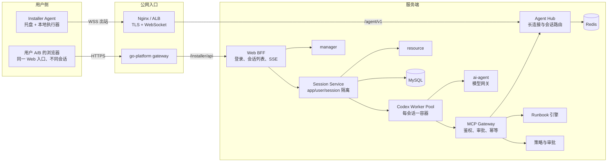
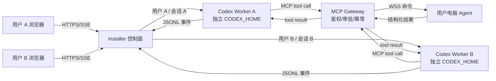

# 装机助手技术方案

> 状态：方案草案，待评审
> 日期：2026-11-13
> 目标：让普通用户通过同一个 Web 平台各自登录，临时启动自己的客户端，接受 AI/人工助手的诊断和软件安装指导；服务端是固定 IP/域名的常驻中台，客户端主动外连，服务端下发受控命令。账号、会话、设备、Agent 上下文和产物必须按用户隔离。
> 范围：方案设计、协议、操作流程、数据模型、安全边界、实施阶段。本文不包含代码实现。

## 1. 结论先行

建议新增一个独立的业务服务 `installer`，不要把设备长连接、会话状态和工具编排直接塞进现有 `ai-agent`。职责划分如下：

| 组件 | 职责 |
| --- | --- |
| `installer` | 装机会话、设备接入、长连接、命令编排、审批、配方、审计 |
| `ai-agent` | 通用模型/密钥/Prompt/调用计量，暴露文本生成能力 |
| `manager` | 用户登录、应用（`X-App-Key`）、角色权限、菜单 |
| `resource` | 安装包、截图、日志等文件对象及临时访问 URL |
| `cron` | 过期会话清理、离线设备清理、审计归档 |

这里的“AI 中台”拆成两层：`ai-agent` 负责模型、密钥、Prompt 和调用计量；`installer` 内的 Orchestrator 负责会话、工具循环、配方选择和审批。这样既复用了现有 AI 能力，又不会把垂直业务塞进通用模型服务。

核心决策：

1. **客户端只主动外连**：使用 `wss://agent.example.com/agent/v1/ws`，客户端不监听任何公网端口，天然适配 NAT、家庭宽带和企业防火墙。
2. **中台常驻，客户端临时**：客户端按需下载/启动，会话结束后退出并清理临时文件，不默认注册为开机服务。
3. **控制通道与业务网关分离**：当前 `server/gateway` 的代理实现没有 WebSocket upgrade/hijack 逻辑，响应路径还会过滤逐跳头；HTTP 重试路径也会读取完整请求体，不适合承载长连接。第一阶段为 Agent 单独配置 Nginx/ALB 入口，直接反代到 `installer:7207`；管理端/用户端 HTTP API 仍走现有网关。
4. **命令必须类型化**：AI 不直接生成任意 shell。MVP 只开放 `host.inspect`、`package.detect`、`package.install`、`package.verify` 等白名单工具；任意命令仅在管理员调试模式下开放，并逐条审批。
5. **安装知识以配方为主**：AI 负责理解意图、选择配方、补参数和处理异常；真正执行的是经过审核的 `runbook`（安装配方）。这样可验证、可回滚、可审计。
6. **提权发生在客户端本地**：Windows UAC / macOS 授权 / Linux sudo 由客户端弹窗，用户在本机确认；服务端永远不接收管理员密码。
7. **所有动作可见、可停、可审计**：客户端常驻托盘状态、显示当前动作和“暂停/终止”按钮；服务端记录会话、计划、命令、输出和审批。
8. **先做 Windows 10/11 x64 + 10 个常用软件**：这是需求密度最高、可验证性最好的 MVP；macOS/Linux 放到下一阶段，屏幕和 UI 自动化最后做。
9. **一个 Web 平台服务多个用户，但用户之间不共享会话**：Codex 只负责单个会话中的推理、工具选择和结构化输出；`installer` 负责 Web 登录、用户隔离、会话、设备绑定、审批和审计。每个用户拥有独立会话、独立 Worker、独立 `CODEX_HOME` 和独立设备绑定。Codex 不直接在客户端执行任意命令，也不承担多租户或设备控制面。
10. **多人协作是显式可选能力，不是默认形态**：默认只有会话所有者能查看和控制自己的会话。后续如需人工坐席，必须由用户邀请并对会话临时授权；不能因为使用同一个 Web 平台就默认看到其他人的会话或设备。

## 2. 与 rs 的关系

`rs` 的模式是“目标机器常驻服务端，操作者从本地临时连接”。装机助手是反过来的：

| 维度 | rs | 装机助手 |
| --- | --- | --- |
| 常驻方 | 被控机器 | 中台（固定域名/IP） |
| 临时方 | 操作者 CLI | 用户电脑上的 Agent |
| 连接方向 | 操作者 -> 被控机器 | Agent -> 中台，出站连接 |
| 网络要求 | 被控机器需可达、通常需端口/隧道 | 只需能访问中台 443 |
| 鉴权 | 节点 token | 一次性激活码 -> 设备凭证 |
| 执行对象 | 任意 shell | 白名单工具 + 审核过的安装配方 |
| 用户体验 | 面向工程师 | 面向普通用户，必须有界面、提示和确认 |
| 会话结束 | 被控服务继续运行 | Agent 退出，临时状态清理 |

因此不能直接复用 rs 的“服务端监听 + 客户端直连”模型，但可以复用其几个原则：单二进制、token 鉴权、命令超时与进程组终止、结构化 stdout/stderr、文件上传/下载分离。

## 3. 现状评估与复用边界

### 3.1 可直接复用

- `manager` 的应用隔离：所有业务请求使用 `X-App-Key`，用户 token 由 manager 校验；`installer` 可以复用同一套中间件和 RBAC。
- `ai-agent` 的模型配置、密钥轮换、Prompt 管理、调用日志和文本生成接口。`installer` 只需要新增一个 gRPC client，调用 `Generate/Text`。
- `resource` 的对象存储与临时 URL 能力。截图、日志、导出报告和需要托管的安装包存对象存储；超大安装包可以直接走官方 CDN，只记录来源、版本和摘要。
- `cron` 的定时任务能力，用于过期会话、离线设备和临时对象的清理。
- 现有 DDD 分层和 proto-first 约定：`app -> domain <- infra`，API 独立模块，错误码由 proto 生成。

### 3.2 现有能力的缺口

- `ai-agent` 目前只有“单次文本/图片生成”，没有会话上下文、工具调用循环、审批和长连接，不适合直接作为 Agent Runtime。
- `server/gateway` 的代理路径没有 WebSocket upgrade/hijack 逻辑，响应转发会剔除 `Connection`、`Upgrade` 等逐跳头；不能把 Agent 长连接直接挂到现有网关。
- `manager` 的设备/会话概念是“用户登录设备”，不等同于“临时被协助电脑”。装机助手需要独立的设备注册和撤销模型。
- 现有应用是 Web/移动端为主，没有面向普通用户的桌面托盘客户端和本地提权交互。

## 4. 总体架构



浏览器侧只有一个统一入口，但不会产生一个共享聊天室。`WebBFF` 每次请求先解析 `app`、用户身份和会话归属，再路由到对应的 `Session`；每个会话只创建自己的 Codex Worker，Worker 只拿到该会话的短期 MCP token。设备连接、消息、审批、日志和产物都按 `user_id + session_id + device_id` 归属。

### 4.1 服务内模块

`installer` 内部建议拆成以下模块，除 Codex Worker 外第一阶段可以同进程部署：

| 模块 | 说明 |
| --- | --- |
| `web` | 用户登录、会话列表、SSE、所有接口的资源归属校验 |
| `session` | 按用户创建会话、消息、状态机、超时和关闭；默认每个会话只有一个所有者 |
| `device` | 激活码、设备注册、设备凭证、在线状态、撤销 |
| `hub` | WebSocket 连接管理、消息序列、心跳、断线重连、命令路由 |
| `worker` | 按会话拉起/销毁隔离的 Codex Worker，注入短期凭证和资源限额 |
| `orchestrator` | 读取当前会话上下文、选择 runbook、调用模型、执行工具、请求审批、验证结果 |

### 4.2 为什么不让 AI 直接接客户端

AI 只面对“工具调用”和“结构化观察”，不直接持有长连接，也不直接决定协议帧。这样可以：

- 在工具层做权限、超时、参数校验、幂等和审计；
- 换模型不影响客户端协议；
- 模型输出异常时仍能由确定性策略兜底；
- 将一次安装拆成可回放、可复现的步骤。

## 5. 端到端操作方式

### 5.1 三种运行模式

| 模式 | 使用者 | 说明 |
| --- | --- | --- |
| 自助模式 | 单个普通用户 + AI | 默认模式；每个用户在自己的会话中使用，AI 诊断并执行配方，用户确认计划和本机提权 |
| 人工协助模式 | 用户 + 受邀坐席 + AI | 用户显式邀请坐席后，坐席才能查看/参与该会话；邀请、接管和撤销都留审计 |
| 受控调试模式 | 管理员 | 仅用于配方开发/疑难排障；高风险工具逐条审批，默认关闭且需要独立权限 |

默认不存在“公共频道”或“共享会话”。普通用户之间不能互相查看会话、设备、截图、日志和安装结果。产品上先做自助模式；会话协议预留邀请与角色字段，但人工坐席只能通过会话所有者显式邀请进入，并且默认只拥有被授予的临时权限。

### 5.2 用户发起安装

1. 用户登录装机助手页面，描述需求，例如“帮我安装微信和 WPS”。
2. AI 先复述目标，说明需要读取系统信息，并请求用户允许启动本机 Agent。
3. 页面生成一次性激活码（默认 5 分钟有效、单次使用），同时提供客户端下载。
4. 用户运行客户端，输入/粘贴激活码，或点击页面上的深链。
5. 客户端生成设备密钥对，向 `installer` 换取设备凭证，建立 WSS 长连接。
6. 页面显示“已连接”，用户看到托盘图标和当前会话 ID。

### 5.3 诊断与计划

7. AI 先调用只读工具 `host.inspect`，获取系统版本、架构、磁盘、网络、包管理器、已安装软件和权限状态。
8. 对目标软件执行 `package.detect`，判断“已安装 / 未安装 / 版本过低 / 存在冲突”。
9. AI 从配方库检索候选方案，生成一份计划：

   ```text
   目标：安装微信 4.x 和 WPS Office
   步骤 1：检查当前版本，确认无需卸载旧版
   步骤 2：下载官方安装包并校验 SHA-256
   步骤 3：静默安装微信
   步骤 4：静默安装 WPS
   步骤 5：启动并验证版本
   预计耗时：3-6 分钟
   需要权限：普通用户；安装阶段可能弹出 UAC
   ```

10. 页面展示计划，用户点击“开始”。高危步骤（重启、修改防火墙、卸载、驱动安装）单独二次确认。

### 5.4 执行与观察

11. 中台下发 `package.install` 命令，携带配方 ID、版本、下载地址、摘要、静默参数和超时。
12. 客户端下载安装包（优先使用资源中心临时 URL 或官方 CDN），校验摘要后执行。
13. 执行器以子进程运行安装程序，流式回传 stdout/stderr；进程树可被 `cancel` 终止。
14. 每一步结束后执行 `package.verify`，检查注册表/应用目录/版本命令/服务状态，而不是只看退出码。
15. AI 根据观察结果决定“继续 / 重试 / 换方案 / 请求人工”，最多 N 步或 M 分钟。

### 5.5 结束

16. 生成结果报告：安装了什么、版本、耗时、失败项、日志和截图（如有）。
17. 用户点击“结束会话”，客户端清理临时安装包和日志，断开连接并退出。
18. 中台保留会话、命令和审批审计；原始大日志归档到对象存储，按保留策略过期删除。

### 5.6 用户主动暂停

用户在任何时刻可以点击“暂停”或“终止”：

- 暂停：不再下发新命令，当前命令若安全可中断则中断；
- 终止：吊销当前会话，杀掉进程组，断开连接；
- 关闭客户端：服务端在心跳超时后把设备标记为离线，会话进入 `interrupted`，不继续下发命令。

## 6. Agent 接入与通信协议

### 6.1 接入流程

```text
用户页面                 installer                       Agent
   |                        |                             |
   |-- 创建会话/激活码 ---->|                             |
   |<-- code, expires ------|                             |
   |-- 用户启动 Agent ----------------------------------->|
   |                        |<-- POST /agent/v1/enroll ---|  code + 设备公钥 + 指纹
   |                        |--- deviceId + deviceToken -->|
   |                        |<== WSS /agent/v1/ws ========|  Bearer deviceToken
   |                        |--- hello_ack --------------->|
   |                        |<-- heartbeat --------------->|
```

激活码必须绑定 `app`、用户 ID、会话 ID 和过期时间；一个激活码只能成功注册一次。设备凭证建议使用短周期 token + 可轮换的 refresh token；服务端只保存 token hash，设备侧保存 deviceToken 和设备私钥，任何一侧都不得把凭证写入日志。

### 6.2 传输选择

| 方案 | 结论 | 原因 |
| --- | --- | --- |
| WebSocket over TLS | **主通道** | 双向、低开销、适合服务端主动下发、浏览器/企业代理支持好 |
| HTTPS 长轮询 | **降级通道** | 应对禁止 WebSocket 的企业网络；延迟略高但足够下发命令 |
| gRPC bidi stream | 不作为一期 | 当前网关会读完请求体后转发，不能透传双向流；且普通用户网络对 h2 支持不如 WSS |
| 纯 MQTT | 不作为一期 | 需要额外 broker 和客户端依赖，收益不足以抵消运维复杂度 |

### 6.3 消息信封

所有消息使用统一的 JSON 信封，二进制内容不直接塞进 WebSocket：

```json
{
  "v": 1,
  "id": "msg_01J...",
  "type": "command",
  "tenantId": "app_01J...",
  "userId": "usr_01J...",
  "sessionId": "ses_01J...",
  "deviceId": "dev_01J...",
  "seq": 42,
  "ts": 1763000000000,
  "replyTo": null,
  "payload": {}
}
```

字段约定：

- `id`：消息唯一 ID，用于幂等和去重；
- `tenantId` / `userId`：消息所属应用和会话所有者，服务端必须与已认证身份、会话记录双向校验；
- `seq`：会话内单调递增，客户端重连后从 `lastSeq` 续传；
- `ts`：毫秒时间戳，超过允许偏差的消息拒绝；
- `replyTo`：响应/结果对应的请求 ID；
- `payload`：按 `type` 定义的结构。

### 6.4 消息类型

| 类型 | 方向 | 说明 |
| --- | --- | --- |
| `hello` | Agent -> Server | 协议版本、系统信息、能力列表、最后确认序号 |
| `hello_ack` | Server -> Agent | 会话、心跳间隔、服务端时间、配置版本 |
| `heartbeat` / `heartbeat_ack` | 双向 | 15s 一次；45s 无心跳判定离线 |
| `command` | Server -> Agent | 类型化工具调用 |
| `command_ack` | Agent -> Server | 已接收/拒绝/需要审批 |
| `command_output` | Agent -> Server | 流式 stdout/stderr，带 `stream` 和 `offset` |
| `command_result` | Agent -> Server | 最终状态、退出码、结构化结果、耗时 |
| `cancel` | Server -> Agent | 取消指定命令并结束进程树 |
| `approval_required` | Agent -> Server | 需要用户本机确认（如 UAC、删除、重启） |
| `approval_result` | Agent -> Server | 用户允许/拒绝 |
| `artifact_offer` | Agent -> Server | 截图/日志等产物的元数据，随后走对象存储 |
| `session_state` | Server -> Agent | 会话暂停、恢复、终止 |
| `config_update` | Server -> Agent | 心跳、采样、日志等级等非敏感配置 |

### 6.5 命令结构

```json
{
  "commandId": "cmd_01J...",
  "nonce": "n_01J...",
  "tool": "package.install",
  "args": {
    "runbookId": "wechat-windows-x64",
    "runbookVersion": 3,
    "downloadUrl": "https://resource.example.com/...signed...",
    "sha256": "....",
    "silentArgs": ["/S"],
    "expectedVersion": "4.0.6"
  },
  "policy": {
    "risk": "install",
    "requiresApproval": false,
    "allowElevation": true
  },
  "timeoutMs": 600000,
  "deadline": 1763000600000,
  "idempotencyKey": "ses_01J...:step:3"
}
```

客户端收到命令后必须：

1. 校验 `commandId`、会话、截止时间、工具是否在本地能力列表；
2. 校验参数 schema，拒绝未知字段和越界值；
3. 检查本地策略（路径、来源域名、摘要、是否需要提权）；
4. 需要用户确认时显示本机弹窗，用户拒绝则上报 `blocked_by_user`；
5. 执行并流式回报，最终只返回一次 `command_result`。

### 6.6 结果结构

```json
{
  "commandId": "cmd_01J...",
  "status": "succeeded",
  "exitCode": 0,
  "startedAt": 1763000010000,
  "finishedAt": 1763000062000,
  "result": {
    "installedVersion": "4.0.6",
    "installPath": "C:\\Program Files\\Tencent\\WeChat",
    "verified": true
  },
  "error": null,
  "artifacts": [
    {"kind": "log", "key": "installer/logs/....log", "size": 18234}
  ]
}
```

约束：

- stdout/stderr 单条消息不超过 16 KiB，按行或按块切分；
- 单命令默认 10 分钟超时，下载类命令可单独放宽；
- 结果必须带 `status`，不能只依赖退出码；
- 大输出超过 256 KiB 时只保留摘要，完整内容上传对象存储；
- 退出码非零、摘要不匹配、用户拒绝、超时都算失败，不能“假装成功”。

### 6.7 重连与幂等

- 客户端断线后指数退避重连（1s、2s、4s，上限 30s）；
- 重连时发送 `hello.lastSeq`，服务端补发未确认消息；
- 服务端对命令使用 `idempotencyKey`，客户端保存最近 N 条已执行命令，重复下发直接返回原结果；
- 超过命令 deadline 的命令不再下发；会话终止后所有未完成命令标记为 `canceled`。

## 7. 工具与安装配方（Runbook）

### 7.1 工具白名单

MVP 工具集：

| 工具 | 风险级别 | 说明 |
| --- | --- | --- |
| `host.inspect` | read | 系统版本、架构、磁盘、网络、权限、已装软件 |
| `package.detect` | read | 按软件标识/版本检测安装状态 |
| `package.download` | low | 下载到临时目录，校验大小与 SHA-256 |
| `package.install` | install | 按配方调用系统包管理器或安装器 |
| `package.verify` | read | 版本、路径、服务、注册表/启动项验证 |
| `service.control` | privileged | 启停服务，需配方声明和审批 |
| `file.upload` | low | 上传日志/截图到对象存储 |
| `artifact.capture` | low | 截图、导出日志（需用户可见提示） |
| `process.list` / `process.kill` | privileged | 仅终止本会话启动的进程树 |
| `system.reboot` | critical | 单独审批，默认禁用 |

`shell.run`、`file.delete`、`registry.write`、`driver.install` 不进入 MVP 的 AI 工具集。需要排障时由管理员在“调试会话”中逐条批准，且必须留下完整审计。

### 7.2 Runbook 结构

配方是版本化、可审核的 YAML/JSON，示例：

```yaml
id: wechat-windows-x64
version: 3
app: installer
platform:
  os: windows
  arch: [amd64]
  minVersion: "10.0.19041"
displayName: 微信
source:
  type: official
  url: https://dldir1.qq.com/weixin/Windows/WeChatSetup.exe
  sha256: "...."
  signature: "Tencent Technology (Shenzhen) Company Limited"
detect:
  - type: uninstall_registry
    key: "HKLM\\Software\\Microsoft\\Windows\\CurrentVersion\\Uninstall\\WeChat"
    versionField: DisplayVersion
install:
  - tool: package.download
    args: {target: "${tmp}/wechat-setup.exe"}
  - tool: package.install
    args: {file: "${tmp}/wechat-setup.exe", silentArgs: ["/S"], timeoutMs: 600000}
verify:
  - type: file_exists
    path: "C:\\Program Files\\Tencent\\WeChat\\WeChat.exe"
  - type: version_command
    command: ["C:\\Program Files\\Tencent\\WeChat\\WeChat.exe", "--version"]
    contains: "4."
rollback:
  - note: 仅关闭安装程序并清理临时文件；不做未经用户确认的卸载
```

配方要求：

- 只允许 HTTPS，优先官方源或公司内部制品库；
- 必须提供 SHA-256；有签名的安装包必须校验签名；
- 静默参数必须按安装器类型配置（MSI/Inno/NSIS/MSIX/winget/brew/apt）；
- 必须有验证步骤；无法验证的安装不能标记成功；
- 回滚只做安全动作，不默认删除用户数据；
- 配方发布需要审核，运行中的会话固定使用创建时的版本。

### 7.3 安装策略优先级

1. 系统包管理器 / 官方静默安装（最稳）；
2. 官方安装包 + 已验证静默参数；
3. 官方安装包 + 有限 UI 自动化（需要用户可看见，仅作为兜底）；
4. 人工远程协助（AI 暂停执行，输出建议和截图）；
5. 拒绝执行并解释原因（无官方源、无法校验、需要付费授权等）。

### 7.4 AI 编排循环

```text
读取用户目标
  -> 收集环境事实（host.inspect）
  -> 检索 runbook / 知识库
  -> 生成计划（JSON）
  -> 用户确认
  -> 选择下一步工具
  -> 策略检查 + 审批
  -> 客户端执行
  -> 结构化观察
  -> 验证/重试/升级处理
  -> 输出结果报告
```

约束：

- 一次只执行一个会改变系统状态的步骤，避免“批量命令黑盒执行”；
- 每步必须声明预期结果和验证方式；
- 总步数、总时长、下载总流量都有上限；
- 连续两次相同失败后停止重试，转为解释或人工接管；
- 模型只能从工具白名单和配方库中选择，不能自行发明下载地址；
- 模型输出使用 JSON Schema 约束，解析失败时回退到确定性流程。

### 7.5 知识库边界

知识库用于帮助 AI 解释问题，不直接扩大执行权限。建议纳入：

- 官方安装文档、系统要求、静默安装参数；
- 常见错误码和排障步骤；
- 公司内部软件目录、授权说明和下载白名单；
- 历史会话的脱敏结论（不含用户个人信息和原始命令输出）。

检索上下文必须带 `software + os + version + errorCode` 等过滤条件，并保留引用来源。没有审核过的配方时，AI 只能生成“建议方案/待审核草稿”，不能直接执行；管理员审核并发布为新配方后，才能进入自动执行路径。

## 8. 安全、隐私与合规

### 8.1 信任边界

- 用户电脑是**不可信执行环境**：客户端可能被篡改、被中间人攻击或处于恶意网络。
- 中台是**高价值控制面**：必须防止越权下发命令、会话劫持和凭证泄露。
- 模型是**不可信决策源**：模型输出必须经过 schema、策略和审批。

### 8.2 关键控制

| 风险 | 控制 |
| --- | --- |
| 未授权接入 | 一次性激活码，绑定会话/用户/app/过期时间，单次使用 |
| 设备凭证泄露 | 短期 token、设备密钥、可撤销、异常登录告警、限制同一用户设备数 |
| 会话劫持 | TLS、短 TTL、绑定设备指纹、服务端会话与连接双向校验 |
| 命令重放 | `commandId` + `nonce` + deadline + 幂等键，服务端和客户端都去重 |
| 恶意安装包 | 官方源白名单、HTTPS、SHA-256、代码签名、下载后校验再执行 |
| 提权滥用 | 客户端本地 UAC/sudo，服务端不接触密码；高危工具逐条审批 |
| AI 幻觉 | 工具/配方白名单、JSON Schema、策略引擎、无配方不执行 |
| 数据泄露 | 日志脱敏、路径白名单、截图用户可见、默认不采集剪贴板和浏览器内容 |
| 跨用户越权 | 所有查询强制带 `app + user_id` 条件；会话/设备/产物逐条 ownership check，越权统一返回 404 |
| Worker 串用 | 每会话独立容器、独立 `CODEX_HOME`、独立临时目录；禁止多个用户复用一个 Worker 或 CLI 进程 |
| 设备并发控制 | 一台设备同一时刻只允许一个会话持有控制租约；同属一个用户也不能并发下发命令 |
| 供应链 | 客户端二进制签名、自动更新校验、配方审核与版本冻结 |
| 滥用/骚扰 | 用户主动启动、可见托盘、随时终止、会话有时长上限、操作审计 |

### 8.3 用户知情与同意

首次连接时必须展示：

- 谁会看到这台电脑的信息；
- AI/助手将执行哪些类型的操作；
- 哪些操作需要逐次确认；
- 会话如何结束、日志保留多久；
- “暂停”“终止”“卸载客户端”的位置。

默认不开启：屏幕持续录制、剪贴板读取、浏览器历史、麦克风/摄像头、开机自启。截图只在排障需要时按次采集，并在客户端显示提示。

### 8.4 审计与留存

每次会话至少记录：

- 创建人、会话所有者、受邀参与者（如有）、`app`、设备 ID、开始/结束时间；
- 用户同意的范围和版本；
- AI 生成的计划和每次工具调用；
- 命令参数摘要、执行结果、退出码、耗时；
- 审批人、审批时间、拒绝原因；
- 安装包来源、SHA-256、配方版本；
- 产物 key、日志保留到期时间。

建议默认保留 30 天，企业版可配置 180 天；包含个人信息的原始输出单独加密/脱敏，删除时同时清理对象存储。

## 9. 数据模型

所有表带 `app`（或 `app_key`）做应用隔离，会话、设备、消息、动作和产物再带 `user_id` 做用户隔离；主键使用雪花/UUID，避免自增暴露规模。建议表名统一加 `installer_` 前缀，避免和现有平台表冲突。查询条件必须同时包含 `app` 和资源所有者，不能只在 Web 前端做过滤。

| 表 | 关键字段 | 说明 |
| --- | --- | --- |
| `installer_device` | id, app, user_id, name, os, arch, fingerprint, public_key, status, last_seen_at | 临时设备登记 |
| `installer_device_credential` | device_id, token_hash, expires_at, revoked_at | 设备凭证，只存 hash |
| `installer_activation_code` | code_hash, app, user_id, session_id, expires_at, used_at | 一次性激活码 |
| `installer_session` | id, app, user_id, device_id, status, mode, worker_id, started_at, ended_at, last_seq | 会话主表；`user_id` 是唯一所有者 |
| `installer_session_participant` | session_id, user_id, role, invited_by, expires_at | 默认只有 owner；仅邀请协作时写入 |
| `installer_message` | id, session_id, role, content, created_at | 对话消息 |
| `installer_plan` | id, session_id, version, status, plan_json, approved_by, approved_at | AI 计划 |
| `installer_action` | id, session_id, plan_id, step, tool, args_json, status, started_at, finished_at | 单个工具调用 |
| `installer_action_output` | action_id, stream, offset, content, truncated | 小输出；大输出存对象存储 |
| `installer_approval` | id, action_id, required_by, status, reason, approved_at | 审批记录 |
| `installer_artifact` | id, session_id, action_id, kind, object_key, size, sha256, expires_at | 截图/日志/报告 |
| `installer_runbook` | id, app, keyword, name, status | 配方主表 |
| `installer_runbook_version` | runbook_id, version, spec_json, sha256, published_by, published_at | 配方版本，会话固定引用 |
| `installer_audit` | id, app, session_id, actor, action, detail_json, created_at | 不可变审计流水 |

索引建议：

- `installer_device(app, user_id, status)`；
- `installer_session(app, user_id, status, created_at)`；
- `installer_session(device_id, status)`，用于检查单设备控制租约；
- `installer_action(session_id, step)`；
- `installer_activation_code(code_hash)` 唯一；
- `installer_device_credential(token_hash)` 唯一。

## 10. API 设计

### 10.1 用户/管理端（走网关，manager token + `X-App-Key`）

| 方法 | 路径 | 说明 |
| --- | --- | --- |
| `POST` | `/installer/api/v1/session` | 创建会话，返回会话和激活码 |
| `GET` | `/installer/api/v1/session` | 会话列表 |
| `GET` | `/installer/api/v1/session/{id}` | 会话详情 |
| `GET` | `/installer/api/v1/session/{id}/events` | SSE 事件流（消息、状态、命令进度） |
| `POST` | `/installer/api/v1/session/{id}/message` | 用户发消息 |
| `POST` | `/installer/api/v1/session/{id}/approve` | 批准/拒绝计划或高危动作 |
| `POST` | `/installer/api/v1/session/{id}/pause` | 暂停 |
| `POST` | `/installer/api/v1/session/{id}/terminate` | 终止 |
| `GET` | `/installer/api/v1/device` | 设备列表 |
| `POST` | `/installer/api/v1/device/{id}/revoke` | 撤销设备 |
| `GET` | `/installer/api/v1/runbook` | 配方列表 |
| `POST` | `/installer/api/v1/runbook` | 新建配方 |
| `POST` | `/installer/api/v1/runbook/{id}/publish` | 发布新版本 |
| `GET` | `/installer/api/v1/audit` | 审计查询 |

响应沿用平台 `{code, reason, message, data}` 格式。SSE 事件建议使用 `event: message|state|action|approval`，每个事件带 `id`，浏览器刷新后用 `Last-Event-ID` 续传。

所有用户端接口都必须从 manager token 解析用户身份，并在 SQL/服务层校验 `app + user_id + session_id` 归属。不能只依赖前端隐藏入口；跨用户访问统一返回 404，避免泄露资源是否存在。SSE 订阅、产物下载和审计查询也必须重复做同样的归属校验。

### 10.2 Agent 端（专用入口，不经现有网关）

| 方法 | 路径 | 说明 |
| --- | --- | --- |
| `POST` | `/agent/v1/enroll` | 激活码换设备凭证 |
| `POST` | `/agent/v1/refresh` | 刷新设备凭证 |
| `GET` | `/agent/v1/ws` | WebSocket 升级，`Authorization: Bearer <deviceToken>` |
| `POST` | `/agent/v1/poll` | 长轮询降级，返回待处理消息 |
| `POST` | `/agent/v1/events` | 批量上报结果（幂等） |
| `POST` | `/agent/v1/artifacts` | 申请产物上传地址 |
| `GET` | `/agent/v1/health` | Agent 入口健康检查 |

Agent 入口必须独立限流、独立审计、单独证书/域名，不暴露管理 API。建议 `agent.example.com` 只开放 `/agent/v1/*`。

### 10.3 内部 gRPC

- `installer -> manager`：`ParseToken`、应用信息、用户信息；
- `installer -> ai-agent`：`Generate/Text`（后续可增加流式生成）；
- `installer -> resource`：对象 URL、上传/下载、临时地址；
- `installer` 内部：`Hub` 与 `Orchestrator` 通过进程内接口；多副本时通过 Redis Stream/NATS 路由。

## 11. 客户端设计

### 11.1 形态

- Go 单二进制，Windows/macOS/Linux 共用协议层；
- MVP 先做 Windows x64 GUI（托盘 + 简单窗口），CLI 作为调试工具；
- 不强依赖管理员权限启动；安装阶段按需提权；
- 启动后不注册系统服务，不默认开机自启；会话结束退出；
- 可选“保留日志到本机”开关，默认关闭；
- 客户端自身更新使用签名包 + 版本白名单，更新失败不影响当前会话。

### 11.2 Windows 关键点

- 支持 MSI、Inno Setup、NSIS、MSIX、winget 的静默/普通安装；
- UAC 提权由单独 helper 进程执行，最小化提权范围；
- 进程树终止使用 Job Object，防止安装器残留子进程；
- 受控目录：临时目录、下载目录、配方声明的路径；
- 检测注册表 Uninstall 项、Program Files、开始菜单、服务；
- 安装前记录系统还原点/卸载入口（能记录则记录，不能则明确告知不可回滚）。

### 11.3 macOS / Linux

- macOS：`.app`/`.dmg`/`.pkg`/`brew`；Accessibility 和屏幕录制权限必须由用户手动授权；
- Linux：优先 `apt`/`dnf`/`snap`/`flatpak`，GUI 自动化只支持 X11，Wayland 需单独评估；
- 两个平台在 Windows 稳定后再启动，避免 MVP 范围失控。

### 11.4 客户端界面

最小界面包含：

- 会话 ID、连接状态、当前软件/步骤；
- “暂停”“终止”“结束”；
- 当前动作说明和风险提示；
- 本机确认弹窗（例如“允许安装程序请求管理员权限”）；
- 结果摘要和“打开日志目录”；
- 明确的隐私说明和卸载入口。

## 12. 部署与运维

### 12.1 端口规划

延续 `deploy/platform` 的端口约定：

| 组件 | HTTP | gRPC | 说明 |
| --- | ---: | ---: | --- |
| installer | 7207 | 8207 | 控制面 API + Agent 入口 |
| installer-web | 7403 | - | 用户端 H5/静态站点（预留） |

`installer` 只监听 `127.0.0.1:7207`，公网由 Nginx/ALB 终止 TLS。

### 12.2 Nginx Agent 入口

```nginx
server {
    listen 443 ssl http2;
    server_name agent.example.com;

    ssl_certificate     /etc/nginx/certs/agent.example.com.pem;
    ssl_certificate_key /etc/nginx/certs/agent.example.com.key;

    location /agent/v1/ {
        proxy_pass http://127.0.0.1:7207;
        proxy_http_version 1.1;
        proxy_set_header Upgrade $http_upgrade;
        proxy_set_header Connection "upgrade";
        proxy_set_header Host $host;
        proxy_set_header X-Real-IP $remote_addr;
        proxy_read_timeout 3600s;
        proxy_send_timeout 3600s;
        client_max_body_size 8m;
    }
}
```

管理端/用户端仍通过 `gateway` 的 `/installer/api/*` 路由访问 `installer:7207`。不要让 Agent 长连接经过当前 `gateway`，否则需要改网关的 upgrade、请求体缓冲和超时逻辑，风险和回归面都更大。

### 12.3 多副本

MVP 单副本即可满足验证。上生产多副本时：

- 设备在线状态写 Redis，带 TTL；
- 会话 owner 节点写入 Redis（`sessionId -> nodeId`）；
- 命令通过 Redis Stream/NATS 投递给 owner 节点；
- 网关按会话做粘性路由或由任意节点转发到 owner；
- 节点宕机时，连接重连并把未确认命令重新投递（仍依赖幂等键）。

不要把 WebSocket 连接状态只放在进程内存里，否则扩容/重启会丢会话。

### 12.4 监控指标

- 在线 Agent 数、连接建立成功率、重连率；
- 会话数、会话时长、异常终止率；
- 命令 P50/P95 延迟、成功率、超时率；
- 下载失败率、摘要校验失败率；
- 安装成功率（按软件/版本/OS）；
- 审批拒绝率、AI 计划被人工修正率；
- 设备凭证撤销数、异常登录数。

## 13. 实施计划

### 阶段 0：方案与协议冻结（2-3 天）

- 评审本文档，确认 MVP 只做 Windows；
- 冻结 Web 多用户模型：默认每个用户只看自己的会话和设备，协作必须显式邀请；
- 冻结消息信封、工具 schema、runbook schema、数据库表；
- 用 `wscat`/Go 小程序验证 Nginx -> installer WebSocket 链路；
- 确认 `ai-agent` 调用方式和模型配置。

**验收**：协议文档、表结构、接口清单签字确认；最小 WebSocket echo/心跳 demo 跑通。

### 阶段 0.5：Codex Runtime 先上线（2-4 天）

- 构建独立 `codex-worker` 镜像，固定 Codex CLI 版本并跑兼容性测试；
- 配置中台统一的模型账号/API 凭证和配额，不复用用户个人 ChatGPT 登录态；
- 用一个假的 MCP 工具验证 `codex exec --json`、`--output-schema`、工具调用回填和超时终止；
- 验证每次调用使用独立 `CODEX_HOME` 和临时 workspace，进程退出后销毁；
- 打通 Worker -> `ai-agent`/模型代理的最小链路，并记录 token、耗时、工具调用和失败原因。

**验收**：两个不同用户并发发起测试会话时，Worker、`CODEX_HOME`、临时文件和调用日志完全分开；任一会话超时或崩溃不影响另一个会话。

### 阶段 1：控制面 + 无 AI 的 Agent（1-2 周）

- 新建 `installer` 服务骨架（用 `framework/kratos-layout`）；
- 实现激活码、设备注册、WSS 连接、心跳、断线重连；
- 实现 `host.inspect`、`package.detect`、`package.download`、`package.verify`；
- 实现用户级会话、命令、审计和最小管理接口，完成 ownership check 和单设备控制租约；
- 提供命令行 Agent，用于联调。

**验收**：用户从页面拿激活码，客户端连接，服务端能下发只读命令并拿到结构化结果；断网 30 秒内自动重连；命令可取消、超时可终止。

### 阶段 2：AI 会话与审批（2 周）

- `installer` 调用 `ai-agent` 生成计划；
- 接入阶段 0.5 的 Codex Worker，每个会话独立拉起、独立回收，不复用用户上下文；
- 实现 SSE 会话流、计划展示、用户确认；
- 实现策略引擎（风险级别、工具白名单、路径/来源校验）；
- 实现 `package.install` 和安装后验证；
- 实现会话终止、进程树清理、日志/截图产物归档。

**验收**：完成一个软件的端到端安装；AI 生成的计划可被用户拒绝；任何执行动作都能在审计里找到命令、结果、审批人。

### 阶段 3：MVP 软件包（2-3 周）

首批建议只做 10 个：

- 微信、WPS Office、Chrome、Edge、钉钉、企业微信、QQ、7-Zip、VLC、Node.js（或 Python）。

每个软件必须有：

- 官方下载源和 SHA-256；
- 安装/升级/检测/验证配方；
- 冲突和旧版本处理说明；
- 至少一次 Windows 10 和 Windows 11 真机验证。

**验收**：10 个软件在干净 Windows 环境安装成功率 >= 90%，失败有可读原因和回退建议；不出现未校验来源执行。

### 阶段 4：桌面 GUI 与体验（2-3 周）

- 托盘客户端、激活码输入、进度和审批弹窗；
- 自动更新与签名校验；
- 结果报告、日志导出、用户反馈；
- Web 会话列表、设备列表、历史记录和所有权校验；
- 基础屏幕截图和“让助手看屏幕”能力（按次授权）。

**验收**：非技术用户能在 3 分钟内完成首次连接；关闭客户端/断网不会导致服务端继续执行；用户能明确终止所有动作。

### 阶段 5：生产化（持续）

- 多副本、Redis 路由、限流和熔断；
- macOS/Linux；
- 企业租户、RBAC、审计导出；
- UI 自动化兜底、更多软件、知识库运营；
- 安全评审、渗透测试、压测和灾备演练。

### 建议的 MVP 范围

只做：Windows 10/11 x64、10 个软件、Web 多用户登录但会话/设备隔离、普通用户安装、AI 计划 + 用户确认、托管配方、审计、托盘客户端、暂停/终止。

不做：任意 shell、无人值守、开机自启、后台静默控制、剪贴板/浏览器读取、macOS/Linux、复杂 UI 自动化、远程桌面、默认共享会话、多人共同控制设备。

## 14. 验收标准

### 功能

- 客户端不需要公网入站端口，家庭宽带和企业 NAT 均可连接；
- 激活码 5 分钟内有效、只能使用一次；
- 断线重连后不重复执行命令，不丢失最终结果；
- 每个安装步骤都有检测、执行、验证三态；
- 用户可以在任意步骤暂停/终止；
- 安装失败时返回可读原因和建议，不把退出码 0 当作安装成功。
- 用户只能看到自己的会话、设备、消息、截图、日志和安装结果；
- 同一用户的多个会话也不能同时控制同一台设备；不同用户并发使用互不阻塞。

### 安全

- 服务端无法获得用户管理员密码；
- 所有安装包都校验来源和摘要；
- 高危动作必须二次确认；
- 命令、审批、结果 100% 可审计；
- 客户端日志不包含 token、密码、完整个人信息；
- 设备撤销后立即无法建立新连接，现有连接被断开。
- 跨用户篡改 `sessionId`、`deviceId`、`artifactId` 或 SSE 参数时均被拒绝；
- 会话结束后 Worker、临时 workspace、`CODEX_HOME`、MCP token 和设备控制租约全部回收。

### 质量

- 10 个 MVP 软件在干净 Windows 环境端到端验证；
- 每个软件至少覆盖“未安装、已安装同版本、已安装旧版本、安装失败”四种状态；
- 关键路径有集成测试：激活、连接、命令、取消、重连、审批拒绝、超时；
- 多用户隔离测试：两个用户并发会话，验证数据、Worker、设备租约和配额互不串用；
- 客户端安装包和更新包有签名；
- 服务端单副本故障后会话可恢复或被明确标记失败，不产生“幽灵安装”。

## 15. 风险与待确认项

| 风险/问题 | 影响 | 建议 |
| --- | --- | --- |
| 安装器没有静默参数 | 无法全自动，可能需要 UI 操作 | 优先选择支持静默的安装包；否则明确提示用户手动点击 |
| 杀毒软件误报 | 客户端或安装器被拦截 | 代码签名、提交白名单、避免可疑行为；提供人工处理路径 |
| UI 自动化脆弱 | 不同版本界面变化导致失败 | 放到最后，只做兜底，不作为 MVP 成功标准 |
| 企业网络封 WebSocket | 无法建立长连接 | 提供 HTTPS 长轮询降级；文档给出代理配置 |
| AI 生成错误命令 | 安全/稳定性风险 | 工具白名单 + 配方审核 + schema + 审批，禁止任意 shell |
| 用户隐私顾虑 | 不愿启动客户端 | 明确同意、可见托盘、随时终止、默认最小采集 |
| 多副本连接路由 | 扩容后会话丢失 | 先单副本；扩容前引入 Redis owner 路由和幂等重投 |
| 现有网关不支持 WS | 接入受阻 | Agent 走独立 Nginx 入口，不改现有网关 |
| Web 多用户做成共享会话 | 用户互相看到设备、日志和安装动作 | 默认单所有者；协作必须显式邀请，所有接口做 ownership check |
| Worker/`CODEX_HOME` 被复用 | 不同用户上下文和凭证串用 | 每会话一容器、一 `CODEX_HOME`、一临时目录；会话结束立即销毁 |
| 同一设备被多个会话抢占 | 命令乱序、安装状态冲突 | 设备控制租约 + Redis 原子锁，同一设备同一时刻只允许一个会话 |
| 单用户滥用资源 | Worker、模型和下载带宽被占满 | 用户级并发、CPU、内存、时长、步数和下载流量配额 |
| 软件授权/许可 | 不能代装付费/受限软件 | 配方只做官方允许的安装方式，不绕过授权 |
| Codex 账号和模型配额 | CLI 可复用不等于账号可共用 | 使用中台独立的服务账号/API 凭证和配额，不依赖用户个人 ChatGPT 登录态 |

需要产品/安全确认：

1. 是否面向公众开放，还是只服务内部员工/客户支持？
2. 首发是否只支持 Windows？
3. 是否允许助手看到屏幕截图？默认按次授权还是全程共享？
4. 会话和日志的保留周期、是否允许导出？
5. 首批 10 个软件清单和官方下载源白名单。
6. 是否需要“人工坐席接管”以及坐席的权限分级。

## 16. 使用 Codex CLI 作为 Agent Runtime

### 16.1 能复用和不能复用的部分

Codex CLI 可以作为“单会话 Agent Runtime”，复用它的模型推理、工具选择、工具结果回填、上下文压缩和结构化输出能力，不需要再实现一套通用 tool loop。但它不是装机助手，也不解决 Web 多用户登录、会话隔离、设备控制和审计问题。`codex` 本身没有内置的团队 Web 账号体系，不能把多个用户直接接到同一个 CLI 进程或同一个 `CODEX_HOME`。

| 能力 | Codex CLI | `installer` |
| --- | --- | --- |
| 理解自然语言、选择下一步工具 | 提供 | 提供 Prompt、配方和策略约束 |
| 读取工具结果并继续推理 | 提供 | 负责工具白名单、超时、幂等和审计 |
| JSONL 事件流和结构化最终输出 | 提供（`codex exec --json`、`--output-schema`） | 转成会话消息、计划和执行事件 |
| MCP 工具接入 | 提供 | 提供按会话隔离的 MCP Gateway |
| Web 多用户登录、每用户会话隔离 | 不提供 | 自建 Web BFF + Session Service |
| 显式邀请的协作角色、@mention | 不提供 | 可选自建，默认关闭 |
| 设备激活、反连、命令路由、断线重连 | 不提供 | 自建 |
| 安装审批、用户确认、人工接管 | 不提供 | 自建 |
| 多租户、RBAC、审计和留存 | 不提供 | 复用 `manager` 并扩展 |

结论：Codex CLI 只替换 `orchestrator` 里的“通用 Agent 循环”，不能替换 `installer`。尤其是“服务端下发命令”这一层，仍必须由设备 Hub 和客户端执行器完成。

本机已核验的 CLI 版本为 `codex-cli 0.164.0-alpha.11.1`，它是单用户命令行工具，不是多用户 Web 服务。下列能力以该版本为准，升级后需要重新跑兼容性验证：

- `codex exec --json` 输出 JSONL 事件；
- `codex exec --output-schema` 约束最终输出；
- `codex exec --sandbox read-only|workspace-write|danger-full-access`；
- `codex exec resume` / `fork`；
- `codex mcp add --url` 和 `--bearer-token-env-var`；
- `codex app-server`、`codex exec-server` 目前均为实验能力，不作为 MVP 的稳定依赖。

### 16.2 推荐落位：服务端隔离 Worker，不放进 `installer` 主进程

推荐把 Codex CLI 装进独立的 **Agent Worker 镜像**，每次会话启动一个短生命周期容器。Codex 运行在服务端，但只通过受限 MCP Gateway 操作用户电脑上的执行器：



这样做的原因：

- 普通用户不需要安装、登录或升级 Codex CLI，客户端仍然是轻量单二进制；
- Codex 版本、模型配置和 Prompt 由中台统一升级，避免客户端版本碎片化；
- Codex 进程不持有设备 token，只持有当前会话的短期 MCP token；
- 主 `installer` 服务不执行模型生成的代码，故障和资源消耗被隔离在 Worker；
- 后续可以在不改会话协议的情况下，把 Worker 换成 Eino、OpenHands 或其它 Runtime。

不能把 Codex CLI 直接装进 `installer` 主容器后以 root 运行，也不能让它直接访问 Docker socket、宿主机目录、数据库凭证或用户设备 token。Worker 必须是：

- 非 root、只读根文件系统、独立临时目录；
- 不挂载宿主机用户目录、Docker socket 和云凭证；
- 网络只允许访问模型网关、`installer` 内网 MCP Gateway 和必要的包下载白名单；
- 单会话 CPU/内存/时长/步数限额，默认 10 分钟后终止；
- 每会话独立 `CODEX_HOME`，只放生成的 `config.toml` 和短期模型凭证，不读取个人 Codex 配置。

用户隔离规则：

- 一个用户可以有多个会话，但每个会话仍使用独立 Worker、`CODEX_HOME` 和临时 workspace；
- 不同用户绝不能共享消息、文件、环境变量、模型凭证、MCP token 或设备 token；
- Worker 注入的上下文只包含当前会话所有者的消息、当前设备事实和已批准动作；
- 会话结束后销毁 Worker，不把 CLI 本地会话文件当作业务状态或跨会话记忆。

### 16.3 调用方式

MVP 采用“一轮用户消息 = 一次 `codex exec`”的方式，而不是长期运行一个不可审计的交互进程。`installer` 保存完整会话，在每次调用时把最近消息、当前计划、已批准动作和环境事实裁剪后注入 Prompt：

```bash
export CODEX_HOME="/var/lib/installer/runtime/codex/${SESSION_ID}"

codex mcp add installer-tools \
  --url "${INSTALLER_MCP_URL}" \
  --bearer-token-env-var INSTALLER_MCP_TOKEN

INSTALLER_MCP_TOKEN="${SESSION_MCP_TOKEN}" \
codex exec \
  --ephemeral \
  --skip-git-repo-check \
  --sandbox read-only \
  --json \
  --output-schema /etc/installer/schemas/turn-output.json \
  -C "/var/lib/installer/workspaces/${SESSION_ID}" \
  "$TURN_PROMPT"
```

约束：

- `--sandbox read-only` 只能限制 Codex 自身的内置写操作，不能替代容器隔离；仍需空文件系统和最小挂载；
- 禁止使用 `danger-full-access`，禁止把宿主机 shell 暴露给 Codex；
- `--output-schema` 只约束最终输出，工具参数还必须由 MCP Gateway 做第二次校验；
- 每轮设置 token、步数、工具调用次数和总时长上限；
- 会话上下文由 `installer` 持久化，不依赖 CLI 的本地会话文件；需要长任务续跑时再评估 `codex exec resume`；
- `app-server` 和 `exec-server` 可以另做 PoC，但在实验标记移除前不进入生产链路。

### 16.4 MCP Gateway 是唯一执行入口

Codex 不直接持有 WebSocket，也不直接下发客户端命令。MCP Gateway 按 `sessionId` 找到当前设备，并只暴露与 7.1 节一致的工具白名单。每次调用必须完成：

1. 校验 MCP token 对应的 `app`、用户、会话、设备和有效期；
2. 校验工具名、参数 JSON Schema、路径、下载源、版本和摘要；
3. 检查设备控制租约和审批策略，确保同一设备只被一个会话操作；
4. 对需要审批的动作创建 `approval_request`，Gateway 阻塞等待用户/坐席决定；
5. 审批通过后生成带 `requestId` 的客户端命令，校验幂等并转发；
6. 把客户端结构化结果、退出码摘要、耗时和审计 ID 回填给 Codex；
7. 对工具输出标记 `untrusted`，防止安装日志中的文本变成新的指令。

审批必须绑定“动作摘要”，而不是只绑定一句“允许继续”：审批记录至少包含 `sessionId`、`deviceId`、工具名、参数 hash、配方版本、发起人、审批人、过期时间和 `nonce`。设备、参数或配方版本变化后，旧审批立即失效。

### 16.5 Web 多用户如何映射到 Codex Worker

Codex 本身是单用户、单 Agent 会话。装机助手的 Web 多用户应当映射为“多会话”，而不是把多个用户拼进一个 Codex 进程：

```text
用户 A 浏览器 -> installer 会话 A -> Codex Worker A -> MCP -> 用户 A 的设备
用户 B 浏览器 -> installer 会话 B -> Codex Worker B -> MCP -> 用户 B 的设备
```

一次用户消息进入 Agent 的流程：

```text
user A 的 message
  -> 校验 app + user + session 归属
  -> 读取该会话的历史、计划、审批和设备事实
  -> 生成裁剪后的 Turn Prompt
  -> 启动/复用该会话专属 Codex Worker
  -> 把计划、工具调用和结果写回 session A
```

必须遵守：

- **默认单所有者**：MVP 中每个会话只有一个 `requester`，也就是会话所有者；没有共享时间线。
- **每会话独立上下文**：消息、计划、审批、设备租约和 Worker 都绑定 `session_id`，不同用户不能互相读取。
- **每会话独立 Worker**：不复用一个 Codex 进程服务多个用户，也不共享 `CODEX_HOME`、workspace、MCP token 或环境变量。
- **一次只跑一个 Turn**：同一会话同一时刻只允许一个 Agent Turn，避免工具调用和用户消息乱序；不同用户可并行。
- **CLI 不作为业务状态**：会话历史存 `installer`，每轮重新构造 Prompt；使用 `codex exec --ephemeral`，不依赖本地会话文件。
- **可选协作**：如果后续增加坐席，只能由所有者显式邀请；观察者默认只读，不能触发 `package.install`、`service.control` 或 `system.reboot`。

因此，“多人使用同一个 Web”与“多人共享同一个会话”是两件不同的事。前者是 MVP 必需的登录和隔离能力，后者是后续可选功能。

### 16.6 客户端运行 Codex 的备选方案

如果未来要求“用户机器离线也能规划”或“数据尽量不出本机”，可以把 Codex CLI 放进客户端 Agent。但它不适合作为一期主方案：

| 维度 | 服务端隔离 Worker | 客户端内置 Codex |
| --- | --- | --- |
| 升级和版本一致性 | 容易 | 客户端碎片化，需自动更新 |
| 普通用户安装成本 | 低 | 高，包体和依赖更大 |
| 模型账号/密钥 | 中台统一管理 | 需要短期代理凭证，泄露面更大 |
| 数据位置 | 环境事实和结果会上传 | 可以留在本机，但仍需回传审计 |
| 安全边界 | 容器隔离，易做资源限制 | 依赖客户端本机权限和签名 |
| 多用户会话 | 控制面统一处理 | 仍要控制面处理，CLI 不提供 |

一期推荐服务端 Worker；客户端只保留受控执行器。把 Runtime 抽象成 `AgentRuntime` 接口，保留以后切换为客户端 Codex、Eino 或其它框架的空间。

## 17. 开源框架调研与选型

> 调研时间：2026-11-13。以下结论基于公开文档和仓库许可证；许可证和商业条款在采购前必须由法务复核。

### 17.1 目标运行形态：Web 多用户、会话隔离

装机助手需要的是“一个 Web 平台服务很多用户”，而不是“很多人进入同一个会话”：

| 能力 | 含义 | MVP |
| --- | --- | --- |
| 多用户 Web 登录 | 每个用户用自己的账号登录同一站点 | 需要 |
| 用户级数据隔离 | 用户 A 看不到用户 B 的会话、设备、日志和产物 | 必须 |
| 每用户独立会话 | 每个用户可创建多个自己的会话，各有独立上下文 | 需要 |
| 每会话独立 Worker | 每个会话一个隔离的 Codex Runtime 和 `CODEX_HOME` | 需要 |
| 同一会话多人参与 | 多人共享一条消息时间线并共同处理 | 后续可选，默认关闭 |
| 多人共同控制设备 | 多个人能同时给同一台电脑发命令或审批 | 禁止；同一设备只允许一个控制租约 |

因此，选型时首先看“多账号 + 用户隔离 + 每会话独立运行时”，不能把“共享频道”当成主需求。

### 17.2 现成多用户 Web 产品对比

| 方案 | 多用户 Web / 会话隔离 | Agent 与工具能力 | 设备反连与装机执行 | 对装机助手的结论 |
| --- | --- | --- | --- | --- |
| Claude Code Cloud + self-hosted environments | 支持浏览器、手机、桌面和终端发起独立 cloud session；self-hosted runner 在客户网络内执行，控制面仍由 Anthropic 托管 | Claude Code 原生 Agent、工具和 MCP | 面向代码仓库和开发环境，没有普通用户电脑的安装执行器 | 可作为“多用户 Agent Web”的成熟参考，但不适合直接作为装机助手 |
| Coder | 自托管 Web 平台，每个用户有自己的 Workspace；Terraform 定义环境，WireGuard 连接，空闲回收 | Coder Agents / Coding Agents Registry 可运行 Claude Code、Codex、OpenCode 等 | 执行环境是开发 Workspace，不是用户家里的电脑 | 最接近“自托管多用户 Web”，但偏开发者平台，成本和场景不匹配 |
| CloudCLI UI | 自托管 UI，可管理 Claude Code、Codex、Cursor CLI 的多个会话；开源版没有 Team Sharing | 依赖本地 CLI 和用户自己的订阅 | 没有装机设备通道 | 适合个人或小团队 PoC，不适合公网多用户生产平台 |
| Open WebUI Channels | 支持多用户、频道、线程、@mention、访问控制，但默认是共享频道模型 | 模型、工具、MCP、RAG 可回到频道 | Tether 有桌面反连，但不是受控安装和设备租约模型 | 适合研究实时协作层，不作为装机控制面 |
| Codex CLI | 没有 Web 多用户、账号和团队权限；只是单用户命令行 Agent | 提供 `codex exec --json`、MCP、结构化输出 | 无设备反连和设备控制 | 只作为每个会话背后的 Runtime，不直接暴露给用户 |

补充事实：

- Claude Code Cloud 可从浏览器 `claude.ai/code`、手机、Desktop、终端进入；官方文档说明 cloud session 默认运行在 Anthropic 托管基础设施上。
- Claude Code self-hosted environments 目前是 Team/Enterprise 的 public beta，默认关闭。Runner 和 session process 可在客户网络内运行，但控制面仍在 Anthropic；仓库文件留在客户侧，对话、Prompt 和工具结果仍会到 `api.anthropic.com`，并保存 transcript。
- Coder 的 Workspace 由 Terraform 定义，通过 WireGuard 访问，可运行 Claude Code、Codex 等 Agent；它解决的是“多用户开发环境”，不是“普通用户装机”。
- CloudCLI 自托管版读取本机 `~/.claude` 会话，开源版没有 Team Sharing；CloudCLI Cloud 才提供托管环境和团队能力。

结论：现成产品能证明“多用户 Web + 独立 Agent 会话”可行，但没有一款同时满足“普通用户电脑反连 + 受控安装 + 设备租约 + 装机审计”。装机助手需要自建 Web 控制面与设备通道。

### 17.3 Open WebUI Channels 底层是什么

从 Open WebUI 当前开源实现看，Channels 不是一套独立的 Agent 控制面，而是“持久化协作聊天层 + 模型调用入口”：

- 后端使用 `python-socketio` 的 ASGI server 实时推送消息；单实例可直接运行，多实例通过 Redis manager 同步房间和事件，并支持 WebSocket/polling 降级。
- 频道、成员、访问授权和消息引用落在数据库模型中，例如 `channel`、`channel_member`、access grants 和 message 关联；频道是持久化对象，不是进程内临时房间。
- 在频道里 @ 模型时，走的是 Open WebUI 原有的 chat-completion pipeline，因此工具调用、MCP、RAG、文件附件和结构化回复都能复用。
- 它解决的是多人共享上下文和实时协作；设备控制、每会话独立 Worker、安装审批和用户电脑反连仍需要另外建设。

所以 Open WebUI Channels 可以作为“共享会话体验”和“实时消息层”的参考，但不能直接承载装机设备的命令路由。

### 17.4 开源框架候选矩阵

| 项目 | 多用户 Web / 隔离 | Agent/Runtime | 设备反连 | 对装机助手的结论 |
| --- | --- | --- | --- | --- |
| Open WebUI | 有账号、权限和共享 Channels；共享 ≠ 默认隔离 | 模型、工具、MCP、RAG | Tether 可桌面反连，但不是设备控制面 | 只做协作层参考或内部 PoC |
| Coder | 自托管多用户 Workspace，隔离较成熟 | 可运行 Codex/Claude Code 等 | 开发环境，不是普通用户电脑 | 架构参考；不建议作为一期底座 |
| CloudCLI | 多会话 UI，开源版缺团队共享 | 包装本地 CLI | 无 | 个人 PoC；不适合公网多租户 |
| OpenHands | 开源版偏个人/小团队，企业版有多用户和集中审计 | Agent Server、沙箱、工具调用 | 沙箱不是用户电脑 | 借鉴控制面/运行时/沙箱分层 |
| LibreChat | 多用户、组、RBAC、Admin Panel | Agent、MCP、工具 | 无 | 账号与权限参考 |
| Dify | 工作区成员、角色、工作流和人工输入节点 | 工作流、Agent、MCP | 无 | 审批和编排参考 |
| Mattermost + Agents | 团队频道和 Agent 插件 | MCP、工具策略、审计 | 无 | 协作参考，不做设备层 |
| Chatwoot | 客服分配、私密备注、人工接管 | Captain AI 辅助客服 | 无 | 二期人工坐席可选 |
| Tactical RMM / MeshCentral | 多账号设备管理 | 远程 shell、文件、远程桌面 | 有成熟 Agent/反连 | 只借鉴设备接入、心跳和分发 |

许可证和商业条款必须在采购前由法务复核；不要仅凭“源码可见”就假定可以无条件商用，尤其是 Open WebUI 的企业功能、Dify 的多租户运营和 RMM 产品的赞助版能力。

### 17.5 推荐方案与隔离边界

一期推荐：

```text
同一 Web 入口
  -> 用户 A 登录 -> 会话 A -> Codex Worker A -> MCP -> 用户 A 的设备
  -> 用户 B 登录 -> 会话 B -> Codex Worker B -> MCP -> 用户 B 的设备
```

推荐组合：

| 层 | 选择 | 原因 |
| --- | --- | --- |
| Web 控制面 | 自建 `installer-web` + `installer` BFF | 复用 manager 登录、`X-App-Key` 和现有 RBAC |
| 会话与设备状态 | `installer` + MySQL + Redis | 能做用户归属、设备租约、审计和断线恢复 |
| Agent Runtime | 独立 Codex Worker 池 | 复用 Codex CLI 能力，又保留每会话隔离 |
| 工具入口 | MCP Gateway | 统一做工具白名单、审批、幂等和审计 |
| 用户电脑 | 轻量 Agent + 本地执行器 | 只出站连接，不开放公网端口 |
| 协作能力 | 默认关闭，显式邀请 | 避免把“同平台使用”误做成“共享会话” |

必须验证的隔离边界：

- 数据库查询同时带 `app + user_id`，跨用户访问返回 404；
- SSE、产物下载和审计查询重复做 ownership check；
- 每个会话独立 Worker、`CODEX_HOME`、workspace、MCP token；
- 一台设备同一时刻只有一个会话持有控制租约；
- Redis key、对象存储 key 和日志字段都带 `app/user/session` 前缀；
- 用户级并发、CPU、内存、时长、工具调用次数和下载流量限额；
- 会话结束回收 Worker、临时文件、MCP token、设备租约。

### 17.6 建议的验证顺序

1. **先验证单会话 Codex Worker**：用假 MCP 工具返回系统信息，确认 `codex exec --json` 的工具调用、结构化结果、审批拒绝和超时终止。
2. **再验证多用户并发隔离**：用户 A、B 同时创建会话，检查 Worker、`CODEX_HOME`、临时文件、消息和日志互不可见。
3. **再验证越权防护**：用用户 B 的 token 访问用户 A 的 `sessionId`、`deviceId`、SSE 和 artifact，全部返回 404 或拒绝。
4. **再验证设备控制租约**：同一台设备被两个会话尝试连接时，只允许一个会话持有租约；租约释放后才能被另一个会话接管。
5. **最后验证外部协作层（可选）**：如果确实需要坐席，再由会话所有者显式邀请；不要把 Open WebUI Channels 或 Chatwoot 直接接进主执行链路。

### 17.7 在线 Agent 能力调研（2026-11）

本节结论不是给在线 Agent 做热度排名，而是回答两个问题：哪些产品已经验证了“多用户 Web + 隔离会话 + 长任务”的产品形态，哪些架构可以复用。在线 Agent 产品迭代很快，不能因为某个产品当前很火，就把它当作装机助手的基础设施依赖。

#### 17.7.1 在线编码 Agent

这类产品最接近本项目的 Agent Runtime 形态：用户在 Web 或移动端创建任务，服务端启动隔离会话，Agent 调用工具、等待审批并持续汇报状态。

| 产品 | 公开形态 | 值得借鉴 | 不能直接作为装机控制面的原因 |
| --- | --- | --- | --- |
| Claude Code Cloud | 从浏览器、移动端、桌面端和终端使用；每个会话有独立执行环境，也支持组织自托管环境 | 多端会话连续性、并行会话、云端与自托管执行环境并存 | 目标仍是代码仓库和开发任务；不提供普通用户设备注册、Windows 安装器或 UAC 处理 |
| Cursor Cloud Agents | 从 Web、Slack、GitHub 等入口派发任务，云端 Agent 在隔离环境中工作并回写结果 | 多入口任务派发、异步状态、隔离执行和结果回写 | 绑定代码仓库与 Cursor 工作区，不是通用桌面运维通道 |
| GitHub Copilot cloud agent | 将任务分配给云端 Agent，在 GitHub Actions 等环境中执行，并通过分支和 PR 交付 | `client + session + environment` 的职责拆分，以及 Web/IDE/移动端共享同一会话 | 权限模型围绕仓库和组织；无法操作用户本机的安装向导、系统服务与注册表 |
| Devin | 云端软件工程师，具备 shell、编辑器、浏览器和并行任务，支持 Slack/Teams/API 与人工接管 | 长任务编排、任务看板、人工接管、企业 RBAC/SSO | 执行环境是受控的开发沙箱，不是分布在公网后的个人电脑 |

共同点很明确：**用户入口、会话状态和执行环境是三层，不是把终端直接暴露到浏览器里**。这也是本项目必须坚持的结构。

#### 17.7.2 通用在线 Agent

| 产品 | 公开形态 | 值得借鉴 | 边界 |
| --- | --- | --- | --- |
| Replit Agent | 用自然语言生成和修改应用，提供计划模式、检查点、后台任务、测试与发布 | 计划/检查点、任务进度可视化、失败后回滚、从生成到交付的闭环 | 面向 Replit 托管应用，不是跨设备软件安装 |
| Manus Browser Operator | 通过本地浏览器扩展操作用户已登录的浏览器，也支持隔离云浏览器 | 本地桥接、逐次授权、随时停止、用户可见的操作过程 | 只覆盖浏览器动作；不能替代安装包校验、提权、服务安装和卸载 |

通用 Agent 的产品完成度已经较高，但“能点浏览器”不等于“能安全地在一台陌生电脑上安装软件”。后者需要设备身份、权限边界和可审计的执行协议。

#### 17.7.3 执行框架与协作层

| 项目 | 定位 | 对本项目的价值 |
| --- | --- | --- |
| Coder | 控制面 + 工作区 + 隔离执行环境的自托管平台 | 参考控制面与 Runner 解耦、工作区生命周期、模板化环境 |
| OpenHands | 可自托管的 Agent 平台，区分 OSS 与企业能力 | 参考 Agent 会话、沙箱执行、事件流和企业治理边界 |
| Open WebUI Channels | 基于 Socket.IO 和持久化成员关系的多人频道，复用既有模型调用链路 | 只适合作为坐席协作或会话邀请层，不是设备控制面 |

这里要特别区分“能多人聊天”和“能安全执行设备操作”。Channels 解决的是消息广播、成员和房间问题；装机助手还需要设备归属、控制租约、命令幂等、审批和审计。

#### 17.7.4 应该借鉴什么

1. **产品层**：工作区/项目权限、会话列表、跨端续接、任务状态、计划与检查点、人工接管、失败恢复。
2. **执行层**：控制面与 Runtime 分离；每个会话独立 workspace、凭证和资源配额；Runner 可水平扩容，异常时可回收重建。
3. **安全层**：高风险工具逐次审批、操作过程可见、敏感动作二次确认、完整审计；默认不共享会话，协作必须显式邀请。
4. **交付层**：Agent 不只返回一段文字，而是产出结构化结果、日志、截图/录屏和可回放的执行记录。

对应到本项目，一期仍然采用：

```text
Web 用户 -> installer 控制面 -> 独立 Codex Worker -> MCP Gateway -> 用户设备 Agent
```

Codex CLI 负责理解意图和调用工具；控制面负责身份、会话、设备租约和审计；设备 Agent 负责在用户电脑上执行受控命令。三者职责不能合并。

#### 17.7.5 为什么不直接把在线 Agent 当底座

- 它们主要面向代码仓库、云沙箱、IDE 或浏览器，不面向“普通用户把自己的电脑接入平台”这个场景。
- 它们没有设备注册、WSS 反向连接、设备租约、安装配方、安装包校验、Windows UAC 和卸载回滚模型。
- SaaS 的多租户隔离保护的是其自身工作区，不会自动把隔离边界延伸到用户个人电脑。
- 在线 Agent 的产品生命周期变化很快，适合借鉴交互和架构，不适合作为长期不可替换的基础设施。
- 装机涉及提权、驱动、系统服务和软件来源可信度，必须由自有控制面掌握审批与审计，不能把最终执行权交给不可控的第三方会话。

因此，一期选用 Codex CLI 作为 Agent Runtime，但设备接入、命令网关、审批、租约和审计全部自建。在线 Agent 只作为产品体验和执行架构的参考，不进入关键控制链路。

### 17.8 参考资料

- Claude Code Cloud：https://code.claude.com/docs/en/claude-code-on-the-web
- Claude Code self-hosted environments：https://code.claude.com/docs/en/self-hosted-environments
- GitHub Copilot cloud agent：https://docs.github.com/en/copilot/concepts/agents/coding-agent/about-coding-agent
- Cursor Cloud Agents：https://cursor.com/docs/cloud-agent
- Devin 介绍：https://docs.devin.ai/get-started/devin-intro.md
- Devin 文档索引：https://docs.devin.ai/llms.txt
- Replit Agent：https://docs.replit.com/features/agent/overview
- Open WebUI Channels：https://docs.openwebui.com/features/channels/
- Open WebUI Channels 源码入口：https://github.com/open-webui/open-webui
- Open WebUI Tether：https://docs.openwebui.com/ecosystem/tether/
- Open WebUI Open Terminal：https://docs.openwebui.com/features/open-terminal/
- Coder：https://github.com/coder/coder
- OpenHands Enterprise vs OSS：https://docs.openhands.dev/enterprise/enterprise-vs-oss
- OpenHands Agent Canvas：https://docs.openhands.dev/openhands/usage/agent-canvas/overview
- CloudCLI UI：https://github.com/siteboon/claudecodeui
- OpenAI AgentKit：https://openai.com/index/introducing-agentkit/
- Manus Browser Operator：https://manus.im/
- Cursor：https://cursor.com/
- GitHub Copilot：https://github.com/features/copilot
- Browser Use：https://browser-use.com/
- Google Antigravity：https://antigravity.google/
- LibreChat Shareable Links（官方明确说明没有 multi-user group chat）：https://www.librechat.ai/docs/features/shareable_links
- LibreChat Admin Panel：https://www.librechat.ai/docs/features/admin_panel
- Mattermost Agents 多人工具调用：https://github.com/mattermost/mattermost-plugin-agents/blob/master/docs/features/multiplayer_tool_calling.md
- Dify License：https://github.com/langgenius/dify/blob/main/LICENSE
- Chatwoot：https://github.com/chatwoot/chatwoot
- Agno：https://github.com/agno-agi/agno
- Tactical RMM：https://github.com/amidaware/tacticalrmm
- MeshCentral：https://github.com/Ylianst/MeshCentral

## 18. 建议的下一步

1. 先评审本文档，冻结“Web 多用户、用户隔离、每会话独立 Worker”的一期形态；共享会话不作为 MVP。
2. 先完成阶段 0.5：把 Codex CLI 打包成线上隔离 Worker，打通模型网关、`codex exec --json` 和最小 MCP 链路。
3. 用 2-3 天做 `Codex Worker + MCP Gateway` 的最小 PoC，确认工具调用、审批拒绝、超时和多用户并发的隔离。
4. 建 `server/installer` 独立仓库/子模块，先落用户归属、会话、设备租约、审批和审计表，再做 WebSocket PoC。
5. 用 1 个软件（建议 7-Zip 或 Chrome）打通“激活 -> 连接 -> 检测 -> 下载 -> 安装 -> 验证 -> 审计”全链路。
6. 链路打通后再把 Codex 接入真实安装流程，不要让 AI 先于确定性执行能力上线。
7. 在真实干净 Windows 机器上做 10 轮安装回归，并补两个用户并发、越权和设备租约的隔离测试，再考虑 GUI 和 macOS/Linux。
